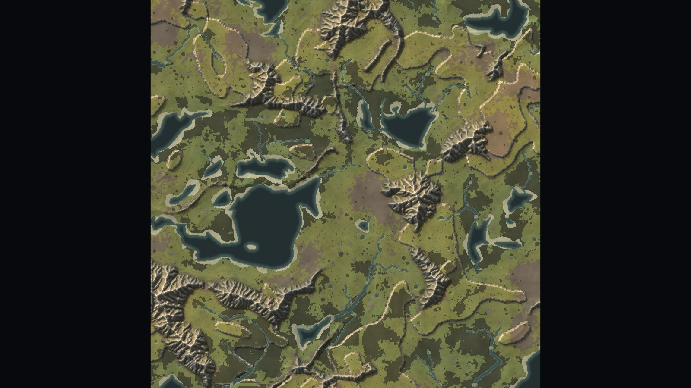
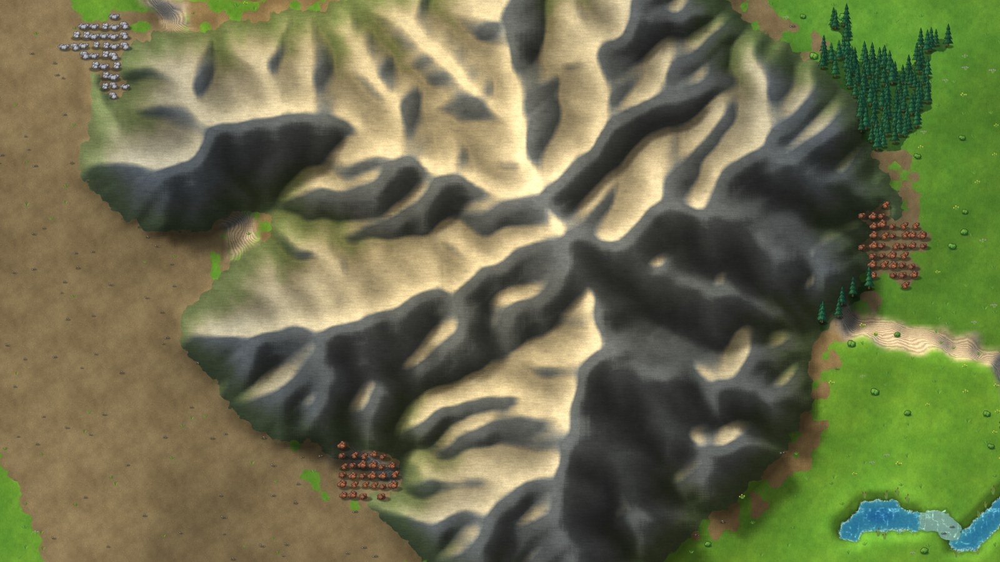
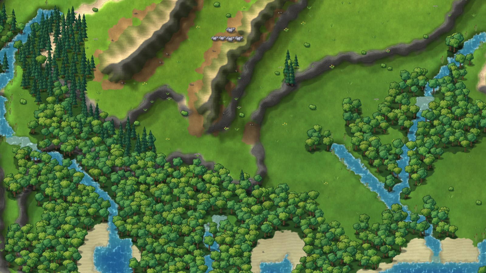
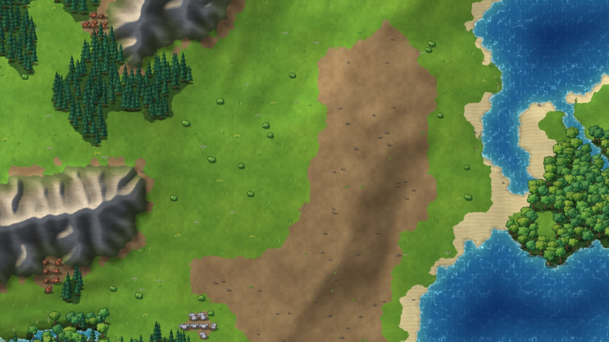
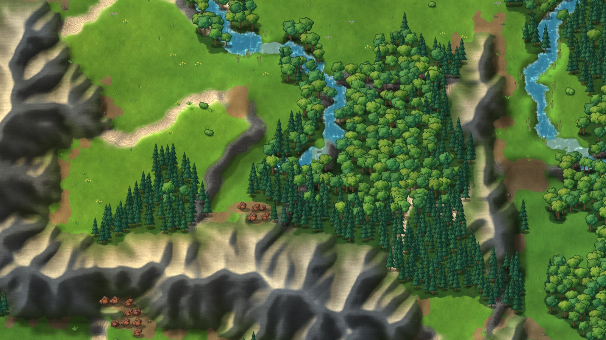
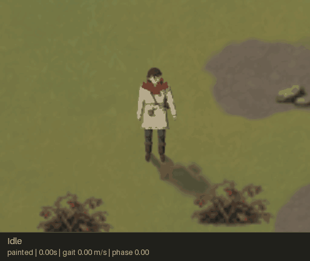

# Zillions

A colony-survival strategy game in the spirit of *They Are Billions*, written in
C++20 on a small custom engine.

You build and fortify a colony on a procedurally generated map, gather wood,
stone and ore to grow it, and hold out against ever-larger zombie hordes that
pour in from the map edges. The terrain is the defence: cliffs, rivers and
mountains funnel the horde through ramps, fords and passes, and the game is
about choosing which chokepoints to hold. See [the design notes](docs/design.md).

The engine, map generator and a playable human character are built. The colony,
economy and horde are still to build.



| | |
|---|---|
|  |  |
|  |  |

## Generated artwork

The viewer draws the map with painted art: seven image-model ground textures
and forty scenery sprites following the [art brief](docs/art-direction.md).
Files live in `assets/ground` and `assets/sprites`, and the
[art showcase](docs/art/showcase.md) has contact sheets at four zoom levels and
tiled ground proofs. The screenshots on this page are taken with that art.


## The player's character

Walk a human character around the map with WASD or the arrows; Shift sprints
and Ctrl strolls. The camera follows until Tab releases it. Trees in front of
the character fade, cliffs and deep water block movement, and fords slow the
character and cover its feet with water and ripples.

The figure is built and animated entirely in code, then painted into a small
transparent texture every frame and drawn as a sprite. Soft filtering, flatter
shading and quieter detail match the terrain. A jointed skeleton drives the
clothes, face, hair, hood and belt gear. C chooses another seeded look, X raises
the hood, and 1 restores the hero. F6 compares the painted sprite with the
smooth procedural drawing; animation stays live in both styles.
The [character notes](docs/character.md) explain the rig, gait and shader and
record the visual and performance checks.



## Building

Needs CMake 3.21+, a C++20 compiler and OpenGL 3.3. GLFW and stb are fetched at
configure time. On Linux, GLFW also needs the X11 or Wayland development
packages (`libxrandr-dev libxinerama-dev libxcursor-dev libxi-dev
libxkbcommon-dev libgl-dev` on Debian/Ubuntu; add `-DGLFW_BUILD_WAYLAND=OFF` if
you have no Wayland headers).

```sh
cmake -S . -B build
cmake --build build -j
./build/game/zillions --seed 7
ctest --test-dir build        # headless tests
```

`-DZL_BUILD_APP=OFF` builds only the headless parts (generator, tests, tools),
which need no windowing system or GPU.

## Running

```
zillions [--seed N] [--size N] [--resolution 1|2|4] [--width W --height H] [--no-vsync]
         [--assets DIR]
         [--screenshot FILE [--whole-map | --center X Y] [--zoom PIXELS]]
         [--no-character] [--player X Y] [--heading DEG] [--speed M --phase P]
         [--look N] [--hood] [--time SECONDS] [--character-sheet FILE]
         [--character-style painted|smooth]
         [--record-demo DIR --demo-seconds N --demo-fps N]
         [--overlay height|pass] [--grid] [--bench]
```

| Input | Action |
|---|---|
| WASD / arrows | move the character (Shift: sprint, Ctrl: stroll); pan in free camera |
| Tab | switch between camera follow and free camera |
| right- or middle-drag | pan in free camera |
| mouse wheel | zoom about the character while following, or the cursor in free camera |
| C / X / 1 | new seeded look / toggle hood / restore the hero |
| R or Space | generate the next seed |
| F / H | frame the whole map / return to the character (start area with `--no-character`) |
| G | tile grid |
| V | cycle debug overlay: height levels, passability |
| F2 | save a screenshot |
| F5 | reload ground textures and sprites without changing the map or camera |
| F6 | switch the character between painted sprite and smooth rendering |

The painted art is read from `--assets DIR`, or by default from `./assets`, or
failing that from the `assets` folder of the source tree the binary was built
from. If the ground textures or the sprites cannot be loaded, the viewer says
why and draws that group in code instead.

F5 repeats the same asset lookup, so edits can be checked without restarting.
With automatic discovery, a local `assets` directory takes precedence even if
one group is incomplete; the log reports that group's fallback.

`zl_mapgen` is the headless generator: `--out preview.png` writes a flat-colour
preview, `--bench` times generation.

`--no-character` opens the map viewer with a free camera. `--player X Y`
places the character on nearby walkable ground. Screenshot poses use heading
in degrees (0 east, 90 south), speed in metres per second and stride phase in
0..1; water depth is taken from the tile. `--look N` selects a repeatable person
(0 restores the hero), and `--hood` raises the hood. `--character-sheet FILE`
writes 64 poses and looks; `--zoom 256` makes a close-up review sheet.
`--character-style painted` is the default; `smooth` draws the underlying
procedural shapes directly at the screen resolution.

`zillions --bench` times the map renderer off-screen, measures the procedural
figure in both styles at 6, 64 and 256 pixels per tile (including pose,
upload, painting and composition),
then stress-tests the sprite batch with 10,000 to 250,000 moving sprites.

The overlays draw gameplay data per tile, exactly as the simulation sees it.
Height shows level 0 in blue, 1 in yellow, 2 in red, ramps in white and a black
line on every border a cliff blocks:


## Recording GIF demos

The debug recorder generates a repeatable demo through the actual player
controller and renderer: idle, profile walk, turn towards the camera, jog,
sprint away, then stop. The default is an eight-second looping GIF, with
captions showing the stage, time, gait speed and stride phase.

```sh
python3 -m pip install -r tools/requirements-debug.txt
python3 tools/record_demo.py out/player-demo.gif
```

It writes a JSON state log beside the GIF. `--style smooth`, `--look N`,
`--hood`, `--zoom`, `--width`, `--height`, `--fps`, `--seconds` and `--colors`
make targeted reviews easy. `--no-captions` writes the scene alone;
`--rig-overlay` shows the actual arm/leg joints in cyan and orange;
`--keep-frames out/demo-frames` retains the source PNGs in a new or empty
directory. Pass `--binary PATH` for another build. Run `--help` for limits.
The state log includes the projected joints as well as movement and pose blends.

The simulation always runs at 60 Hz and capture time is independent of render
speed. A shared GIF palette keeps colours stable; delays preserve the clip's
duration at frame rates such as 24 fps. On Linux with no `DISPLAY`, the tool
starts `xvfb-run` automatically when Xvfb is installed.

For PNGs without GIF encoding, use the game directly:

```sh
./build/game/zillions --seed 7 --size 256 --resolution 1 --width 512 --height 384 \
  --zoom 128 --record-demo out/demo-frames --demo-seconds 8 --demo-fps 20
```

## Layout

```
engine/core      types, RNG and hashing, job system, clock, images
engine/math      vectors, simplex / fBm / ridged noise
engine/platform  window, OpenGL context, input (GLFW)
engine/gfx       shaders, textures, render targets, 2D camera, sprite batch
game/world       tile map, map generator, CPU preview        (headless)
game/actor       human rig, gait, looks and player controller (headless)
game/render      terrain and figure shaders, relief, art loading and placeholders
game/app         the viewer executable
tools/           zl_mapgen, artwork export, GIF demo recorder
tests/           headless, GPU and GIF encoder checks
assets/          painted ground textures and sprites, and their source sheets
```

`zl_core`, `zl_world` and `zl_actor` have no dependency on a window or GPU, so the
simulation can run in tests, tools and (later) a server.

## Engine notes

- **Up to five draw calls with a painted character, four in smooth mode, two
  for the map alone.** The ground is
  one full-screen shader pass: each pixel looks up its four nearest tiles in a
  data texture and blends their materials, so cost depends on screen
  resolution, not map size. Everything
  standing on the ground is one instanced draw: 28 bytes per sprite written
  straight into mapped GPU memory, quad corners derived from `gl_VertexID`.
  With the character, scenery is split north and south of its feet. Painted
  mode first renders the visible poses to a GPU atlas at up to 64 pixels per
  tile, then composites them in one sprite batch between those slices. Smooth
  mode uses one figure pass instead. Empty scenery slices are skipped.
- **Job system.** A persistent thread pool with a blocking `parallel_for`;
  chunks are claimed with a single atomic add.
- **Determinism.** All randomness comes from seeded hashes and PCG32; noise is
  stateless. A seed produces the same map on any number of threads (tested).
- **Fixed timestep** scaffolding is in place for the simulation.
- **Painted art with placeholders behind it.** Ground textures and sprites are
  PNG files, read at start-up and packed into a texture array and one sprite
  atlas. Each also has a placeholder drawn in code, used when the files are
  missing, so the game runs without its assets. Water patterns and shader noise
  are always generated. The brief for the art is in
  [docs/art-direction.md](docs/art-direction.md).

## Map generation

### Size and resolution

A map is `size` × `size` tiles, and `resolution` is how many tiles span one
world unit. Every feature the generator makes (lakes, ranges, river widths,
beaches, ramps, the start area) is sized in world units, so the two settings
do different things:

- **`--size`** with the same resolution gives a bigger world: more lakes, more
  ranges, more ground to cover.
- **`--resolution`** with the size scaled to match gives the same world on a
  finer grid: every pass, ford and plateau is more tiles across, so more
  buildings and units fit in the same place.

The default is 512 × 512 tiles at 2 tiles per world unit. The same seed at
`--size 256 --resolution 1` or `--size 1024 --resolution 4` is the same
geography at half or twice the detail. Resolution must be 1, 2 or 4.

Sizing everything in world units would leave a fine grid empty: the big
features sit many tiles apart with bare ground between them. So a second layer
of features is sized in tiles instead: stands of trees, lone trees, boulder
outcrops, ponds, frayed wood edges, and grass interleaved with bare earth.
Their density is per tile, which means a screenful of map holds about the same
amount of them at any resolution. `MapGenParams::detail` scales that density.

Noise is evaluated once per world unit and interpolated up to the tile grid,
and the relief texture is laid out in world units too, so a finer grid costs
far less than its tile count suggests.

A 1024 × 1024 map at the default resolution, four times the area of the default:


### Steps

`generate_map()` takes a seed and a few coverage parameters and runs these steps:

1. **Noise fields** (parallel): domain-warped fBm for rolling land and lake
   basins, plus ridged noise gated by a low-frequency mask so mountains gather
   into ranges. Sea and mountain levels are taken as percentiles, so requested
   coverage holds for every seed.
2. **Start area**: elevation near the centre is squeezed into the plains band.
3. **Lakes**: everything below sea level, minus ponds and islets.
4. **Rivers**: a priority flood from every lake and map edge gives each tile a
   downhill neighbour; summing upstream area gives flow; tiles with enough flow
   become river. Rivers therefore rise in high ground, merge, never run uphill
   and end in a lake or leave the map.
5. **Mountains**: consolidated with a majority filter; specks are dropped.
6. **Height levels**: smoothed elevation is cut into three flat levels at
   percentiles. Ledges too narrow to use, including the thin skirts that
   would otherwise ring every mountain, are lowered, and the start area is
   kept on a single level.
7. **Terrain**: beaches along lakes, forest in groves biased to wet ground,
   dry ground interleaved with turf, scree at the foot of mountains.
8. **Small features**: ponds, boulder outcrops, stands of trees and lone
   trees, scattered per tile (see above).
9. **Fords**: shallow crossings on narrow river reaches.
10. **Ore**: stone, iron and gold where mountains meet open ground, richer ores
   further out; stone and iron are guaranteed near the start.
11. **Ramps**: slopes three world units wide cut into straight stretches of
    cliff, spaced well apart.
12. **Connectivity**: any sizeable region the colony cannot reach is joined by
    the cheapest cut (a ford, a pass, a gap in the trees or a ramp).
13. **Derived data**: walkable/buildable flags, water depth, statistics.

### Height

Every tile has a height level (`TileMap::level`, 0 to 2). Two neighbouring
tiles on different levels are separated by a cliff, which blocks movement
unless one of them is a ramp. `TileMap::can_step(from, to)` is the single rule
for this, and the generator's own reachability analysis uses it. Ramps are
walkable but never buildable, so the routes between levels stay open.
Mountains are separate from levels: they are impassable everywhere.

Height does not affect combat or vision yet; those arrive with units and towers.

For rendering, levels become terraces with rock-faced cliffs and sloping
ramps, and mountains are carved by an erosion model
(`game/render/relief.cpp`): drainage is routed from every mountain texel to the
foot of its range, and heights are rebuilt upwards with a slope that shrinks as
drainage area grows. Channels become valleys, divides become ridges, and the
ridges branch into spurs.
