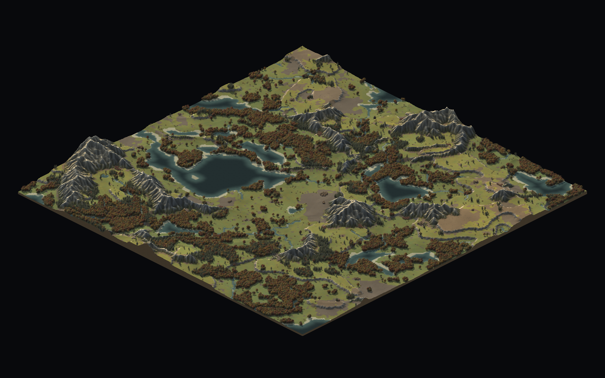
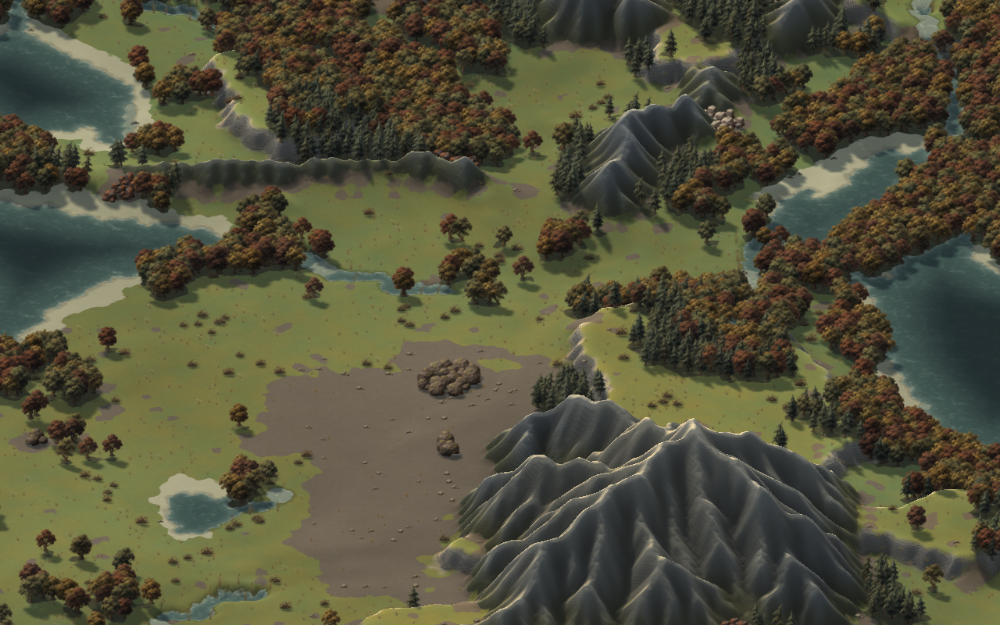
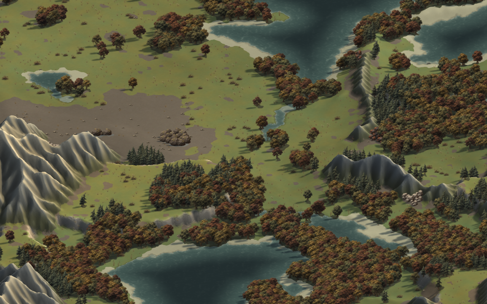
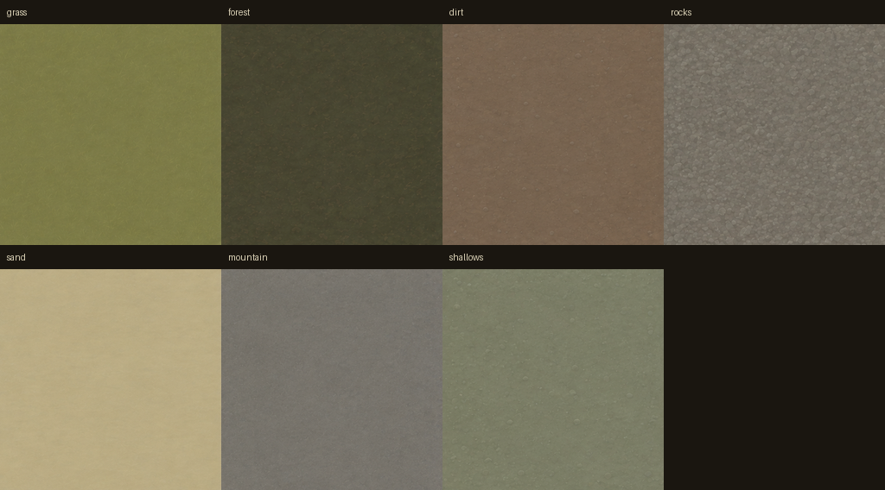
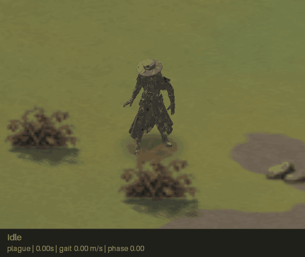
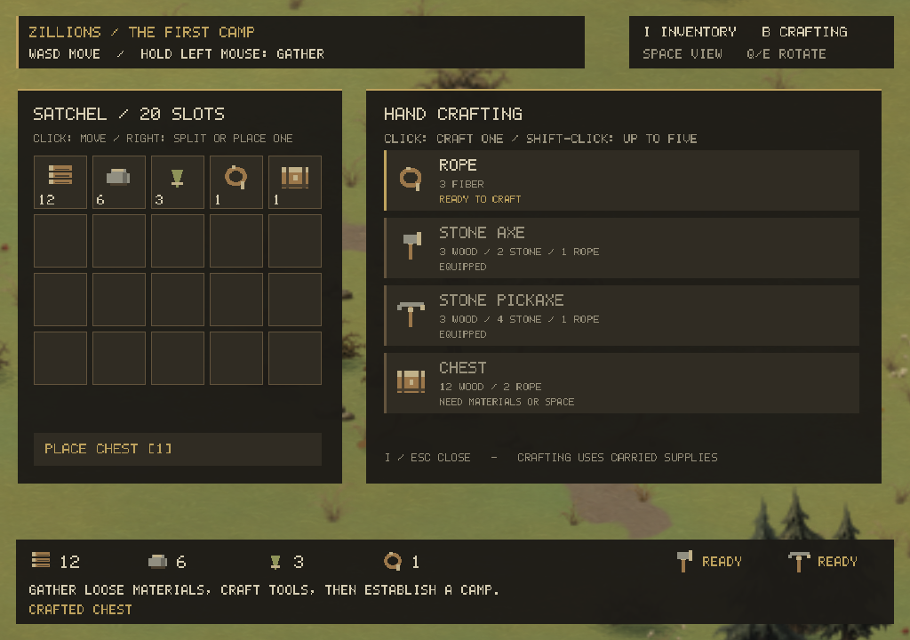
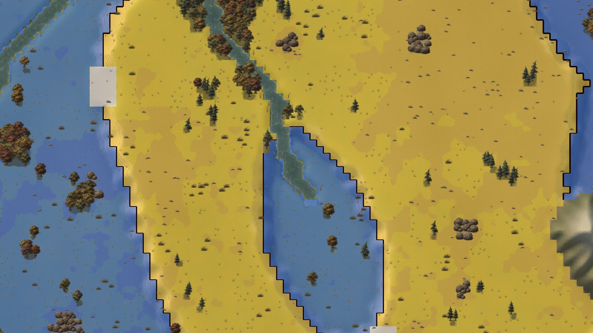
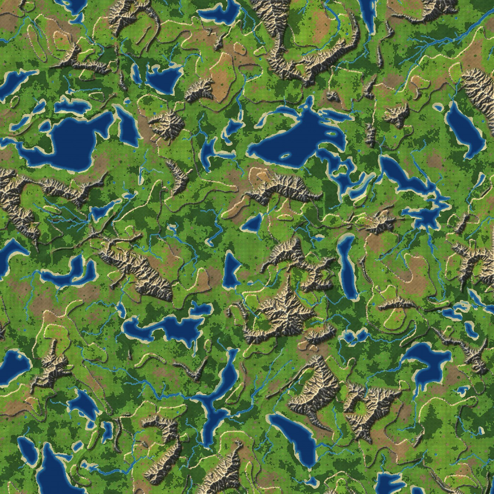

# Zillions

A colony-survival strategy game in the spirit of *They Are Billions*, written in
C++20 on a small custom engine.

You build and fortify a colony on a procedurally generated map, gather wood,
stone and ore to grow it, and hold out against ever-larger zombie hordes that
pour in from the map edges. The terrain is the defence: cliffs, rivers and
mountains funnel the horde through ramps, fords and passes, and the game is
about choosing which chokepoints to hold. See [the design notes](docs/design.md).

The engine, map generator, playable plague doctor and first gathering economy
are built. Gather wood, stone and fiber, craft tools, cut trees, mine stone and
establish a storage chest. Colony workers, buildings and the horde are still to
build.

The world uses a 2:1 isometric view with displaced terrain, raised plateaus,
sloping ramps, depth-tested scenery, and soft cast shadows from a world-space sun. **Q / E** turn the view by 90° around
the terrain at the centre of the screen. See the [isometric viewer notes](docs/isometric.md).



| | |
|---|---|
|  |  |

## Generated artwork

The viewer draws the map with painted art: seven image-model ground textures
and forty scenery sprites following the [art brief](docs/art-direction.md).
Files live in `assets/ground` and `assets/sprites`, and the
[art showcase](docs/art/showcase.md) has contact sheets at four zoom levels and
tiled ground proofs. The screenshots on this page are taken with that art.

The gathering system adds eight image-model world sprites (including four chest
views), seven painted item icons and two held-tool cutouts for the procedural
fallback. Generated masters, exact prompts and export metadata are retained in
`assets/source` and `assets/survival-manifest.json`; see
[the survival art notes](docs/survival.md#art-and-animation).

The player is a skinned glTF model and the tools are static glTF meshes in
`assets/models`: a 24-joint plague doctor with five authored clips, and a 3D
axe and pickaxe that hang from its right hand. The loader, animation state
machine and renderer are described in [the plague doctor notes](docs/plague-doctor.md).
The painted human remains as the missing-model fallback.



## The player's character

Walk the plague doctor around the map with WASD or the arrows; Shift sprints
and Ctrl strolls. Space switches to management mode: the camera pulls back into
a city-builder view that pans when the cursor nears the window borders (or with
WASD / right-drag), while the character patrols and explores the surrounding
area autonomously. Pressing Space again swoops the camera back to the character.
Trees in front of the character fade, cliffs and deep water block movement, and
fords slow the character and cover its legs with water.

The player is a skinned glTF model loaded from
`assets/models/plague_character.glb`. Five authored clips drive it: Idle,
Walking and Running follow the player's speed, `Heavy_Hammer_Swing` chops with
the crafted axe or pickaxe, and `Right_Hand_Sword_Slash` is the hand-gathering
swipe. The 3D tools (`assets/models/axe.glb`, `pickaxe.glb`) hang from the right
hand and follow the swing. The character is lit by the world sun, receives the
cached shadow map, sinks below ford water, casts a soft contact shadow and keeps
the far-zoom marker. The animation state machine crossfades locomotion, scales
playback to each clip's measured stride speed and blends across repeated
strikes. See [the plague doctor notes](docs/plague-doctor.md).

The procedural human is still in the build as the missing-model fallback: it is
built and painted in code, with seeded looks, a hood and painted/smooth styles.
C, X, 1, F6, `--look`, `--hood`, `--character-style` and `--character-sheet`
apply to that fallback; with the model loaded the player's body is fixed to the
hero's dimensions. The [character notes](docs/character.md) document the
fallback rig, gait and shader.



## Gathering and the first camp

Start empty-handed. Hold the left mouse button near the base of fallen
branches, loose stones or bushes to gather wood, stone and fiber. **I** opens
the satchel and **B** opens crafting. Make rope, then a stone axe and pickaxe.
Those tools unlock trees and larger stone deposits. Depleted objects leave
nonblocking stumps or rubble; clearing every solid object frees the tile.

Craft a chest, choose **Place chest** in the inventory, press **T** to rotate it,
and click clear ground
nearby. Open the placed chest nearby and Shift-click stacks to transfer them.
Right-click splits a stack or places one held item. Esc closes a panel or cancels
placement. Supplies and world changes last for this session; saving is not yet
implemented. See [the survival notes](docs/survival.md) for recipes, art and checks.



## Building

Needs CMake 3.21+, a C++20 compiler and OpenGL 3.3. GLFW, stb, libcurl and
nlohmann/json are fetched at configure time. On Linux, GLFW also needs the X11
or Wayland development packages (`libxrandr-dev libxinerama-dev libxcursor-dev
libxi-dev libxkbcommon-dev libgl-dev` on Debian/Ubuntu; add
`-DGLFW_BUILD_WAYLAND=OFF` if you have no Wayland headers). libcurl's OpenSSL
backend needs the OpenSSL development package (`libssl-dev` on Debian/Ubuntu).

```sh
cmake -S . -B build
cmake --build build -j
./build/game/zillions --seed 7
ctest --test-dir build        # headless tests
```

On a multi-config generator (Visual Studio), the binaries are under
`build/game/Release` and `build/tests/Release`; pass `-C Release` to `ctest`.
The headless suite includes `zl_model_tests` (GLB loader) and `zl_plague_tests`
(animation, measured stride speeds and the strike-wrap blend). The GPU model
test is opt-in and needs a display:
`./build/tests/Release/zl_model_render_tests.exe`.

`-DZL_BUILD_APP=OFF` builds only the headless parts (generator, tests, tools),
which need no windowing system or GPU. The build also includes a standalone
OpenRouter client for future model-driven features; gameplay does not use it
yet. See [the OpenRouter notes](docs/openrouter.md).

## Running

```
zillions [--seed N] [--size N] [--resolution 1|2|4] [--width W --height H] [--no-vsync]
         [--assets DIR]
         [--screenshot FILE [--whole-map | --center X Y] [--zoom PIXELS]]
         [--rotation 0|90|180|270] [--no-shadows]
         [--no-character] [--player X Y] [--heading DEG] [--speed M --phase P]
         [--look N] [--hood] [--time SECONDS] [--character-sheet FILE]
         [--character-style painted|smooth]
         [--tool axe|pickaxe] [--work-phase P]
         [--record-demo DIR --demo-seconds N --demo-fps N]
         [--overlay height|pass] [--grid] [--bench]
```

| Input | Action |
|---|---|
| hold left mouse | gather the resource near the cursor's ground position, while in reach |
| I / B | inventory and hand crafting; B switches storage to crafting |
| T during chest placement | rotate world facing; four generated sprites also follow Q/E camera rotation |
| left / right click a stack | pick up or place a stack / split or place one item |
| Shift-click | transfer a stack to/from an open chest; queue up to five crafts |
| Esc | close panel, cancel chest placement, otherwise quit |
| Q / E | rotate the world 90° counterclockwise / clockwise |
| WASD / arrows | move the character (Shift: sprint, Ctrl: stroll); pan in management mode |
| Space | switch between character-follow mode and management mode (autonomous character + city-builder camera) |
| window borders / right- or middle-drag | pan in management mode |
| mouse wheel | zoom about the character while following, or the cursor in management mode |
| C / X / 1 | fallback only: new seeded look / toggle hood / restore the hero |
| Ctrl+R | reset the session with the next seed (R alone in map-only mode) |
| F / H | frame the whole map (in management mode) / centre on the character (start area with `--no-character`) |
| G | tile grid |
| V | cycle debug overlay: height levels, passability |
| F2 | save a screenshot |
| F3 | inspect object collision footprints and height volumes |
| F5 | reload ground textures and sprites without changing the map or camera |
| F6 | fallback only: painted sprite or smooth rendering |

The painted art is read from `--assets DIR`, or by default from `./assets`, or
failing that from the `assets` folder of the source tree the binary was built
from. If the ground textures or the sprites cannot be loaded, the viewer says
why and draws that group in code instead.

Trees, boulders and deposits have world-space collision volumes shared with
their rendered placements. Characters slide around trunks and rounded rock
footprints; canopies and small ground cover remain walkable. See the
[collision notes and contact previews](docs/collision.md). `--colliders` enables
the same inspection overlay as F3 in screenshots.

F5 repeats the same asset lookup, so edits can be checked without restarting.
With automatic discovery, a local `assets` directory takes precedence even if
one group is incomplete; the log reports that group's fallback.

`zl_mapgen` is the headless generator: `--out preview.png` writes a flat-colour
preview, `--bench` times generation.

`--no-character` opens the map viewer with a free camera. `--player X Y`
places the character on nearby walkable ground. Screenshot poses use heading
in degrees (0 east, 90 south), speed in metres per second and stride phase in
0..1; water depth is taken from the tile. `--tool axe|pickaxe --work-phase P`
poses the 3D tool and the matching swing; `--speed` and `--phase` select and
phase the locomotion clip. `--look N` (0 restores the hero), `--hood`,
`--character-sheet FILE` and `--character-style painted|smooth` apply to the
procedural fallback; `--character-sheet` writes 64 poses and looks, and
`--zoom 256` makes a close-up review sheet.

The models are read from `--assets DIR`, or the same automatic `assets` root as
the painted art. If `models/plague_character.glb` cannot be loaded, the log says
why and the procedural human is drawn instead; the axe and pickaxe are optional
and only affect the tool in the plague doctor's hand.

`zillions --bench` times the map renderer off-screen, measures the procedural
figure in both styles and the skinned plague doctor with its axe at 64 and 256
pixels per tile, then stress-tests the sprite batch with 10,000 to 250,000
moving sprites.

The overlays draw gameplay data per tile, exactly as the simulation sees it.
Height shows level 0 in blue, 1 in yellow, 2 in red, ramps in white and a black
line on every border a cliff blocks:



## Recording GIF demos

The debug recorder generates a repeatable demo through the actual player
controller and renderer: idle, profile walk, turn towards the camera, jog,
sprint away, then stop. The default is an eight-second looping GIF, with
captions showing the stage, time, gait speed and stride phase. The live player
is the plague doctor; the capture shows its locomotion clips. The tool swings
are in the stills and in [the plague doctor notes](docs/plague-doctor.md).

```sh
python3 -m pip install -r tools/requirements-debug.txt
python3 tools/record_demo.py out/player-demo.gif
```

It writes a JSON state log beside the GIF. `--style smooth`, `--look N`,
`--hood`, `--zoom`, `--width`, `--height`, `--fps`, `--seconds` and `--colors`
make targeted reviews easy; the style, look and hood options apply to the
procedural fallback. `--no-captions` writes the scene alone; `--rig-overlay`
shows the procedural fallback's arm/leg joints in cyan and orange;
`--keep-frames out/demo-frames` retains the source PNGs in a new or empty
directory. Pass `--binary PATH` for another build; on a multi-config build use
`--binary build/game/Release/zillions.exe`. Run `--help` for limits.
The state log's `rig` entries are the fallback's projected joints, not the GLB
skeleton; the `style` field reports `plague` when the model is active.

The simulation always runs at 60 Hz and capture time is independent of render
speed. A shared GIF palette keeps colours stable; delays preserve the clip's
duration at frame rates such as 24 fps. On Linux with no `DISPLAY`, the tool
starts `xvfb-run` automatically when Xvfb is installed.

For PNGs without GIF encoding, use the game directly:

```sh
./build/game/zillions --seed 7 --size 256 --resolution 1 --width 512 --height 384 \
  --zoom 128 --record-demo out/demo-frames --demo-seconds 8 --demo-fps 20
```

## Layout

```
engine/core      types, RNG and hashing, job system, clock, images
engine/math      vectors, quaternions/matrices, simplex / fBm / ridged noise
engine/net       blocking HTTP(S) transport (libcurl)
engine/platform  window, OpenGL context, input (GLFW)
engine/gfx       shaders, textures, colour/depth targets, isometric and 2D cameras, sprite batch
game/world       tile map, map generator, CPU preview        (headless)
game/asset       glTF/GLB loader, skinning data and texture decode (headless)
game/actor       plague doctor animation, human fallback rig, gait and player controller (headless)
game/ai          OpenRouter chat client
game/render      terrain, figure and skinned-model shaders, relief, art loading and placeholders
game/app         the viewer executable
tools/           zl_mapgen, artwork export, GIF demo recorder
tests/           headless, GPU and GIF encoder checks
assets/          painted ground textures and sprites, their source sheets, and models/
```

`zl_core`, `zl_world`, `zl_assets` and `zl_actor` have no dependency on a window
or GPU, so the simulation and the model loader can run in tests, tools and
(later) a server.

## Engine notes

- **Instanced terrain and scenery.** Visible terrain chunks use a height-displaced
  mesh with distance-dependent tessellation; a second draw closes the map edges
  with rock faces. Scenery uses one instanced draw with 48 bytes per sprite,
  including upright and contact-shadow depth. Quad corners come from `gl_VertexID`.
  With a character, scenery is split before and after its rotated ground depth.
  The plague doctor is a skinned mesh drawn between those slices and writes
  depth; the painted procedural figure remains the fallback and composites from
  a live 64-pixel-per-tile atlas.
- **Skinned player model.** `game/asset/gltf.cpp` loads the GLB, skin and five
  animation clips; `game/actor/plague.cpp` blends locomotion and work clips and
  writes 24 skinning matrices; `game/render/model_renderer.cpp` draws the
  character and the active tool with the isometric projection, the scene's depth
  and shadow map, a waterline cut, a contact shadow and the far-zoom marker.
  The pass is three draw calls, measured at 1.35–1.45 ms per frame at 800×600
  on an AMD RX 560. See [the plague doctor notes](docs/plague-doctor.md).
- **Height and occlusion.** A full-precision height texture drives geometry,
  scenery anchors, and terrain picking. Live windows and screenshot targets both
  have depth buffers. Four scenery orders handle camera rotation, and terrain
  hides objects on the far sides of cliffs and mountains. Character geometry,
  shadows, and movement use the same isometric camera.
- **Directional shadows.** A cached 2048² floating-point sun depth map includes
  terrain and alpha-cutout trees, bushes, boulders and deposits, including offscreen
  casters. Chests and stumps use grounded solid shadow volumes. Terrain, water
  and characters receive filtered shadows with firmer contact edges while
  retaining cool ambient light. The skinned model receives the same map and
  adds a soft contact shadow; it does not refresh the cached caster pass.
  Shadow geometry refreshes after camera or art
  changes. A stationary map-only view uses up to three visible draws; refreshing
  shadows adds two depth draws, plus one for solid props when present.
  `--no-shadows` makes reproducible comparisons.
- **Job system.** A persistent thread pool with a blocking `parallel_for`;
  chunks are claimed with a single atomic add.
- **Determinism.** All randomness comes from seeded hashes and PCG32; noise is
  stateless. A seed produces the same map on any number of threads (tested).
- **Fixed timestep** scaffolding is in place for the simulation.
- **Painted art with placeholders behind it.** Ground textures and sprites are
  PNG files, read at start-up and packed into a texture array and one sprite
  atlas. Each also has a placeholder drawn in code, used when the files are
  missing, so the game runs without its assets. Water patterns and shader noise
  are always generated. The brief for the art is in
  [docs/art-direction.md](docs/art-direction.md).

## Map generation

### Size and resolution

A map is `size` × `size` tiles, and `resolution` is how many tiles span one
world unit. Every feature the generator makes (lakes, ranges, river widths,
beaches, ramps, the start area) is sized in world units, so the two settings
do different things:

- **`--size`** with the same resolution gives a bigger world: more lakes, more
  ranges, more ground to cover.
- **`--resolution`** with the size scaled to match gives the same world on a
  finer grid: every pass, ford and plateau is more tiles across, so more
  buildings and units fit in the same place.

The default is 512 × 512 tiles at 2 tiles per world unit. The same seed at
`--size 256 --resolution 1` or `--size 1024 --resolution 4` is the same
geography at half or twice the detail. Resolution must be 1, 2 or 4.

Sizing everything in world units would leave a fine grid empty: the big
features sit many tiles apart with bare ground between them. So a second layer
of features is sized in tiles instead: stands of trees, lone trees, boulder
outcrops, ponds, frayed wood edges, and grass interleaved with bare earth.
Their density is per tile, which means a screenful of map holds about the same
amount of them at any resolution. `MapGenParams::detail` scales that density.

Noise is evaluated once per world unit and interpolated up to the tile grid,
and the relief texture is laid out in world units too, so a finer grid costs
far less than its tile count suggests.

A 1024 × 1024 map at the default resolution, four times the area of the default:



### Steps

`generate_map()` takes a seed and a few coverage parameters and runs these steps:

1. **Noise fields** (parallel): domain-warped fBm for rolling land and lake
   basins, plus ridged noise gated by a low-frequency mask so mountains gather
   into ranges. Sea and mountain levels are taken as percentiles, so requested
   coverage holds for every seed.
2. **Start area**: elevation near the centre is squeezed into the plains band.
3. **Lakes**: everything below sea level, minus ponds and islets.
4. **Rivers**: a priority flood from every lake and map edge gives each tile a
   downhill neighbour; summing upstream area gives flow; tiles with enough flow
   become river. Rivers therefore rise in high ground, merge, never run uphill
   and end in a lake or leave the map.
5. **Mountains**: consolidated with a majority filter; specks are dropped.
6. **Height levels**: smoothed elevation is cut into three flat levels at
   percentiles. Ledges too narrow to use, including the thin skirts that
   would otherwise ring every mountain, are lowered, and the start area is
   kept on a single level.
7. **Terrain**: beaches along lakes, forest in groves biased to wet ground,
   dry ground interleaved with turf, scree at the foot of mountains.
8. **Small features**: ponds, boulder outcrops, stands of trees and lone
   trees, scattered per tile (see above).
9. **Fords**: shallow crossings on narrow river reaches.
10. **Ore**: stone, iron and gold where mountains meet open ground, richer ores
   further out; stone and iron are guaranteed near the start.
11. **Ramps**: slopes three world units wide cut into straight stretches of
    cliff, spaced well apart.
12. **Connectivity**: any sizeable region the colony cannot reach is joined by
    the cheapest cut (a ford, a pass, a gap in the trees or a ramp).
13. **Derived data**: walkable/buildable flags, water depth, statistics.

### Height

Every tile has a height level (`TileMap::level`, 0 to 2). Two neighbouring
tiles on different levels are separated by a cliff, which blocks movement
unless one of them is a ramp. `TileMap::can_step(from, to)` is the single rule
for this, and the generator's own reachability analysis uses it. Ramps are
walkable but never buildable, so the routes between levels stay open.
Mountains are separate from levels: they are impassable everywhere.

Height does not affect combat or vision yet; those arrive with units and towers.

For rendering, levels become terraces with rock-faced cliffs and sloping
ramps, and mountains are carved by an erosion model
(`game/render/relief.cpp`): drainage is routed from every mountain texel to the
foot of its range, and heights are rebuilt upwards with a slope that shrinks as
drainage area grows. Channels become valleys, divides become ridges, and the
ridges branch into spurs.
