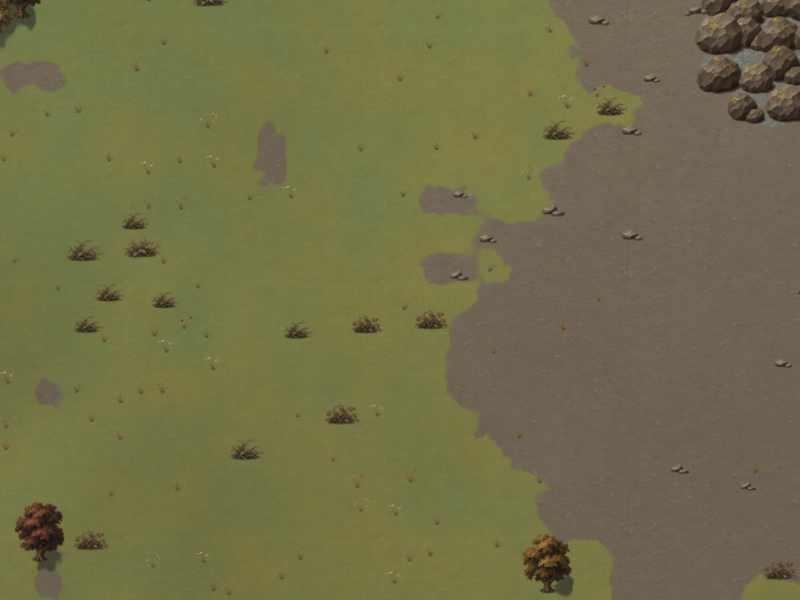
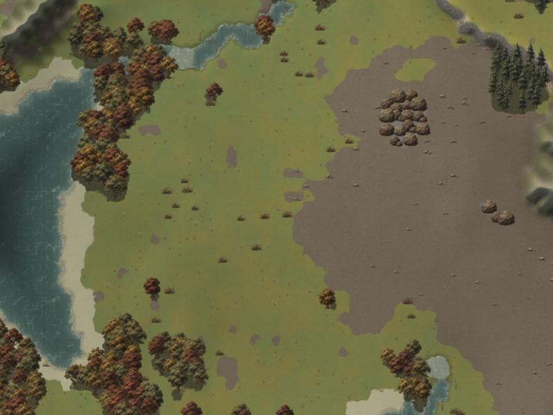
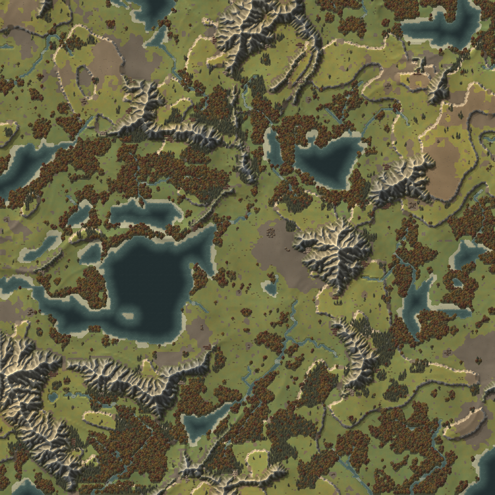
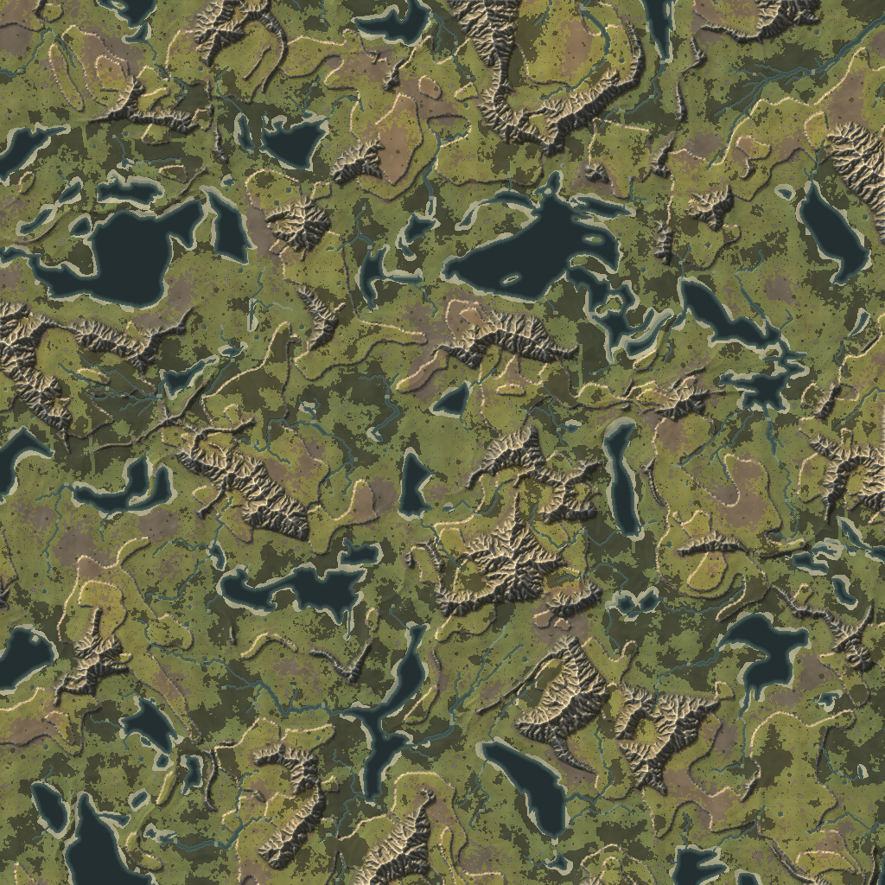

# Painted art in the viewer

The current viewer projects this artwork isometrically; see the
[current screenshots and rendering notes](../isometric.md). Images below record
the original painted-art integration before the isometric conversion.

The viewer loads the seven ground textures and forty scenery sprites at startup.
It converts sprite PNGs from straight to premultiplied alpha exactly once, packs
the fixed-size canvases into one atlas, and leaves water/noise data procedural.
The terrain shader uses the plague-era palette for water, foam, scrub and haze.

These are screenshots of the actual OpenGL renderer, with seed 7 and frozen
water time 0, rather than asset contact-sheet composites.

## Start area, 32 screen pixels per tile



## The same area, 16 screen pixels per tile



## Whole 256 × 256 map



## Whole 1024 × 1024 map

At this scale the renderer culls sprites, and forest ground alone carries the
groves. The palette and haze still distinguish water, sand, earth and grass.



## Finding and reloading art

`--assets DIR` selects an explicit directory. Otherwise the viewer tries the
current directory's `assets` folder and then its build-time source asset folder.
A local directory takes precedence even if incomplete. An explicit missing
directory also takes precedence: neither case silently switches to another
painted set.

F5 rereads that location without regenerating the map or changing the camera.
Ground and scenery load independently: each complete, correctly sized group
loads from PNGs; a missing, corrupt or wrongly sized member makes its entire
group use procedural placeholders. The log identifies the first invalid file.
Restoring the file and pressing F5 brings the painted group back.

Both sources use the same sprite catalogue and atlas coordinates, so existing
scenery remains valid during reload. Atlas slots have 16 px transparent padding,
align to a 16 px grid, and generate mipmaps only through level 4. This keeps
neighbours out of the texture filter at the smallest visible scenery scale.
CPU pixel buffers are released after upload; the catalogue stays available.

## Validation

Validated on Linux with Mesa llvmpipe and Xvfb:

- Normal build and CTest pass, with no compiler warnings.
- A separate `ZL_BUILD_APP=OFF` configure, build and CTest pass without OpenGL
  or window dependencies in the headless art loader.
- Tests compare every painted ground texel with its source and every atlas
  sprite texel with the source's expected premultiplied value. They also check
  slot alignment and transparent guard space for every sprite.
- Missing, corrupt and incorrectly sized last members of both groups exercise
  fallback after earlier files have already decoded; no partial group leaks
  through. Water/noise layers and placeholder determinism are preserved.
- PNG round-trip, missing file and truncated/corrupt file checks verify failure
  leaves the caller's image intact.
- Renderer screenshots pass at 8, 16, 32 and 64 px/tile, at the 2.5 px/tile
  scenery cutoff, just below it, and on whole maps of 256 and 1024 tiles.
  Seeds 3 and 7, fallback art, debug overlays, and launch from outside the
  checkout were also checked.
- An automated live-window check sends F5 while removing/restoring a sprite
  and then a ground texture. It confirms fallback, recovery, F2 screenshots,
  a single map generation throughout, and a clean Escape exit.

To reproduce a start-area screenshot on Linux:

```sh
LIBGL_ALWAYS_SOFTWARE=1 xvfb-run -a ./build/game/zillions \
  --seed 7 --size 256 --resolution 1 --width 800 --height 600 \
  --screenshot /tmp/painted-start.png
```

Existing palette-range and perfect-tiling caveats concern the delivered artwork;
they remain documented in the [asset showcase](showcase.md). They do not change
loading, fallback or the runtime atlas contract.
