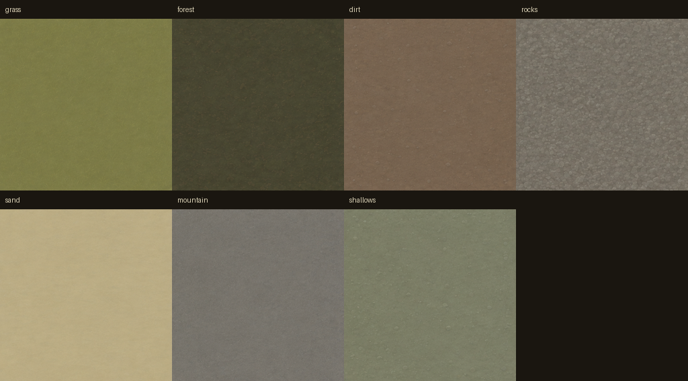
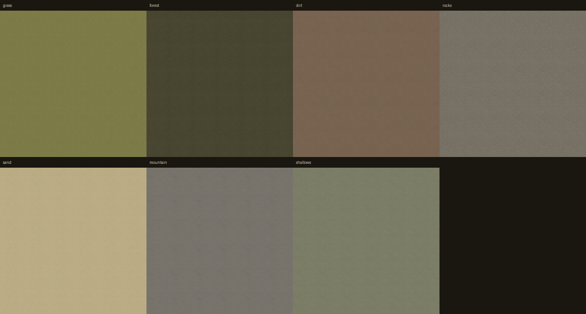
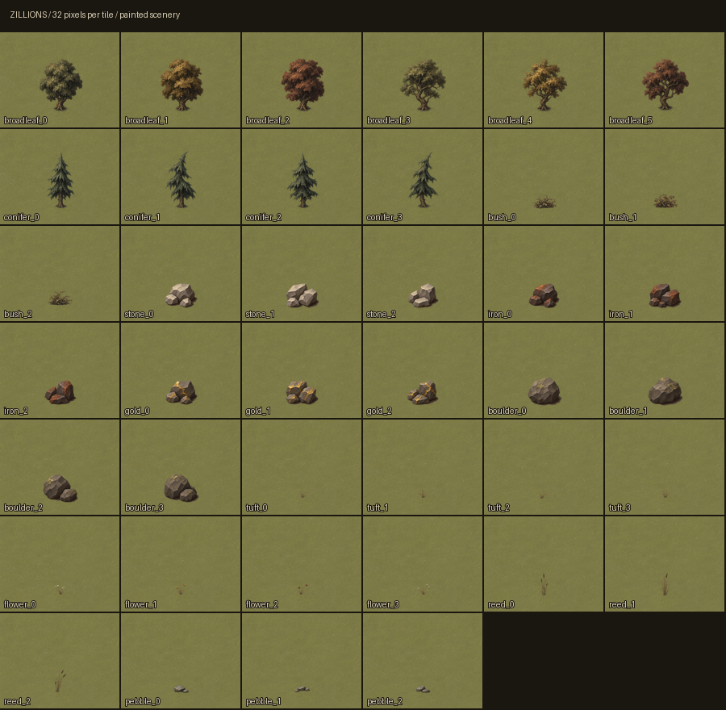
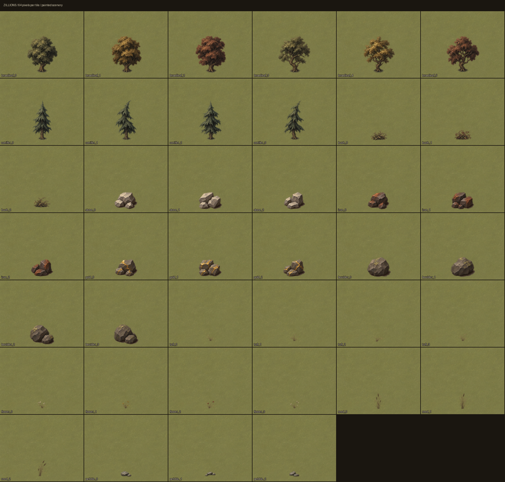
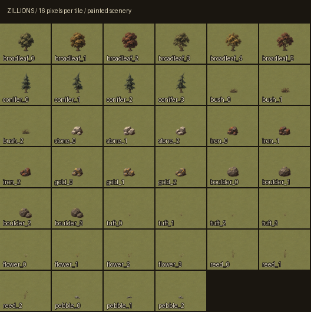

# Generated artwork showcase

Seven ground textures and forty scenery sprites, generated with the image model
using the [plague-era painting brief](../art-direction.md). This is an artwork
delivery for review. The viewer still draws its procedural placeholders; image
loading, runtime premultiplication, atlas upload and shader colour changes remain
the separate integration task described in that brief.

## Ground

All seven exports are opaque, sRGB-tagged, 256 × 256 PNGs. The extra grass panel
in the source sheet is unused. Water and shader noise remain generated in code.



[Full-size 3 × 3 tiling proof](ground-tile-3x3.png). The following proof repeats
each texture 6 × 6 and displays the result at 25%:



The model was asked for seamless, low-contrast materials. The export crops a
three-pixel inset around each source panel to exclude neighbouring materials.
Opposite-edge pixels are not mathematically identical; these are visual tiling
proofs, not a guarantee of periodic continuity under every filtering mode.

## Scenery at authoring scale

The default camera uses 32 screen pixels per tile. Each object is composited on
the generated grass with its manifest anchor aligned to the ground. These are
asset contact sheets, not screenshots of the game renderer.



## Scenery at twice authoring scale



## Readability when small



[8 pixels per tile](sprites-8px.png) is also included. Stone is pale, iron is
dark with rust, and gold has broad yellow veins. Trees and boulders retain solid
silhouettes; ground cover is deliberately slight.

## Delivery and reproduction

- `assets/ground/`: seven ground PNGs named as in the brief.
- `assets/sprites/`: forty PNGs in eleven families, with the prescribed names
  and canvas sizes. Broadleaf variants 0/3 are olive, 1/4 ochre, 2/5 rust.
- `assets/manifest.json`: canvas dimensions, anchors, source rectangles and
  source footprint positions for every exported asset.
- `assets/source/`: four original image-model sheets, kept at generation
  resolution. The ground sheet includes an image-model revision for quieter
  grain, flatter lighting and closer palette colours.

The sprite PNGs store **straight alpha**. Transparent pixels have zero RGB.
Premultiply once before uploading into the renderer's premultiplied atlas.
Anchors are measured from the canvas's upper-left corner, at 32 authoring pixels
per tile. Sources are cropped, scaled without changing aspect ratio, and placed
on transparent canvases around the recorded footprints. Individual object
placement should still be checked in the engine during integration.

To reproduce all exports, the manifest and the contact sheets, use Python 3
with Pillow (validated with 13.0.0):

```sh
python tools/art/export_assets.py
```

The exporter slices and packs the painted source pixels; it does not synthesize
replacement artwork. Source sheets were generated through `image_gen.imagegen`
in this task on 2026-11-09/10 UTC. The tool does not expose a model version or a
reproducible generation seed. Prompts specified the brief's materials, palette,
family counts, elevated camera, upper-left illumination, crisp painted
silhouettes, transparent sprite backgrounds and isolated source-sheet cells.
Exporting from the committed sources is reproducible; regenerating the paintings
from a text prompt will produce different images.

## Palette review

The generated colours follow the intended sombre direction but do not satisfy
every numeric palette constraint in the brief. These are measured mean sRGB
values (rounded), included to make that difference reviewable:

| Texture | Export mean | Brief range |
|---|---|---|
| Grass | `#7C7B47` | `#6E7442`–`#8C8A50` |
| Forest | `#484531` | `#2E3324`–`#454430`, plus litter |
| Dirt | `#776350` | `#6A5646`–`#8A7460` |
| Rocks | `#787165` | `#6C665C`–`#8A8478` |
| Sand | `#BAAB84` | `#B8AC8C`–`#D0C6A6` |
| Mountain | `#77736B` | neutral grey, maximum about 55% |
| Shallows | `#7B7D66` | `#6E7868`–`#90967E` |

Forest is a little lighter than its range; sand and shallows are warmer than
requested, and mountain grain retains a warm cast. The mountain export remains
below the 55% brightness ceiling. Palette matching, sprite contact shadows and
far-zoom ground-cover visibility should be judged with the shader's final
colours during integration. This showcase does not mark the art brief's full
production checklist as complete.

## Validation

The export was checked against the brief for all 47 file counts and canvas
sizes, all 40 anchor coordinates, sprite transparency, zero RGB in fully
transparent pixels, sRGB PNG tags and the mountain brightness ceiling. Contact
sheets were inspected at 16, 32 and 64 pixels per tile, with 8-pixel output
provided for review. Both ground repeat proofs are included above.

The existing C++ build and headless CTest suite also pass. No runtime source or
dependency declarations changed in this artwork delivery.
