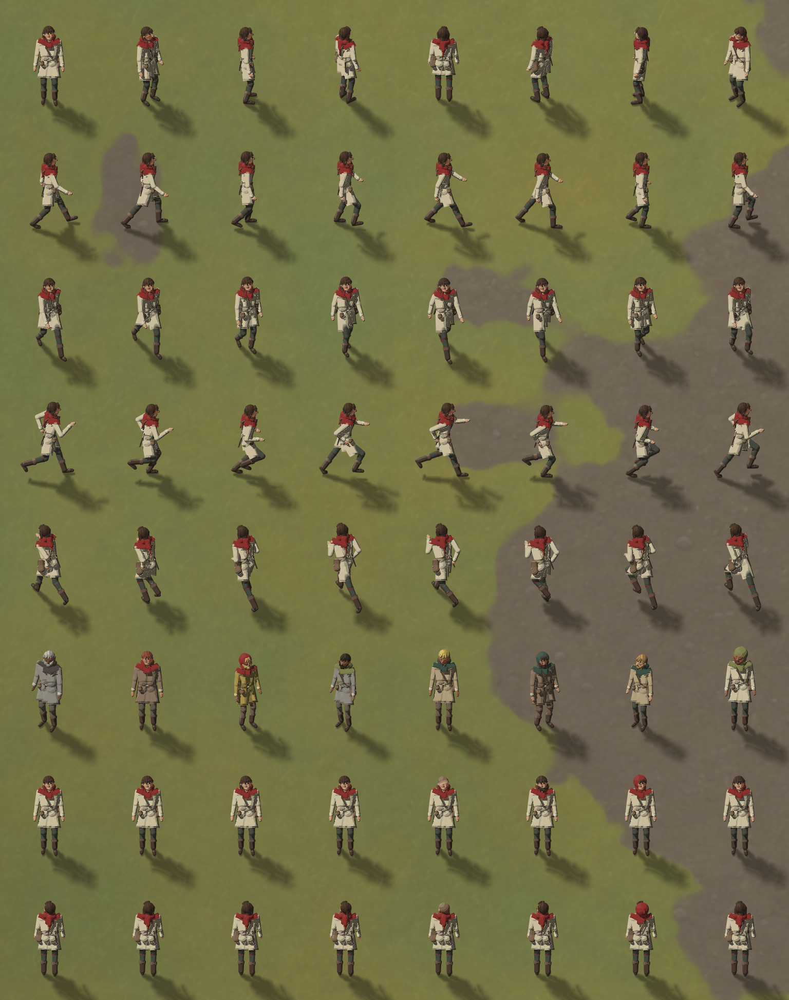
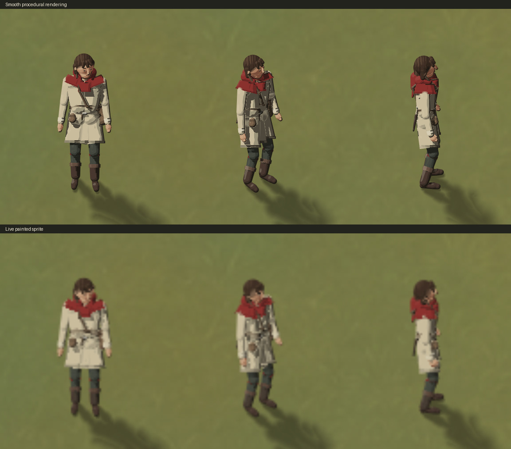
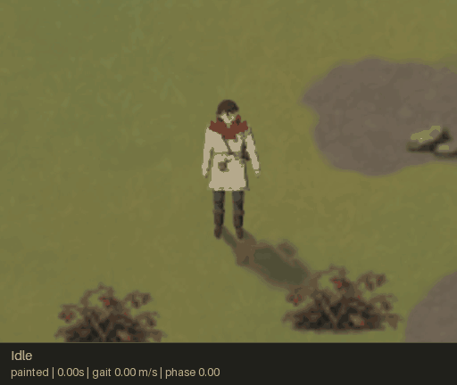
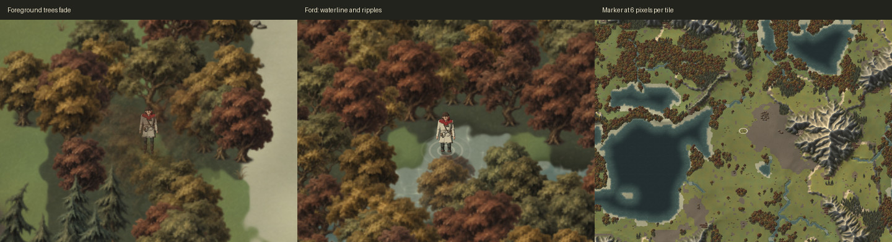

# The player's character

The player can walk one human around a generated map. The character has no
image, mesh or animation asset to load: `game/actor/human.cpp` builds a posed
collection of rounded cones. `game/render/figure_renderer.cpp` paints that live
pose to a small transparent GPU texture, then draws it as a painted sprite.
This implements exploration and movement; colony interactions and combat are
future game features.



The eight rows show standing headings, a profile walk, a walk towards the
viewer, a profile jog, a sprint away, eight seeded looks, and guaranteed hair,
beard, hood and blink variations from the front and back. In the final two rows
the columns are cropped, shaggy, long, tied back, shaved, bearded, hood up and
blinking. The sheet is rendered at 128 pixels per tile; close-ups were also
reviewed at 256.

Painted mode is the default. F6 switches live to smooth procedural rendering
for comparison, or select `--character-style painted|smooth` at startup.



## Recorded animation demo



`python3 tools/record_demo.py out/player-demo.gif` records the normal controller
and renderer, including acceleration, turning, gait changes and camera follow.
The eight-second script idles, walks east in profile, turns towards the viewer,
jogs west, sprints north and settles. It simulates at 60 Hz and interpolates
each requested capture time, so GPU speed does not change the movement or the
GIF's timing. A shared palette and soft painted rendering preserve the look.

The GIF's accompanying JSON logs position, heading, gait speed, stride phase,
torso/arm blends and the projected joints for every captured frame. The
committed [demo state log](character/player-demo.json)
matches this preview. Use `--keep-frames DIR` to retain the PNGs and raw capture
manifest for closer inspection. `--style smooth`, `--look`, `--hood`, `--zoom`
and the frame rate/size/duration options support focused comparisons.
`--rig-overlay` draws the actual joints over the character: cyan on the left,
orange on the right, with a pale spine. It exposes the limbs hidden by the
torso, so pose and rendering problems can be reviewed separately.

## Rig and gait

`HumanLook` holds body scale, build, colours and clothing choices. `hero_look()`
returns the linen-clad hero with a red hood; `random_look(seed)` is deterministic
and samples the same muted palette. Five hair styles, an optional beard,
raised hood and satchel change the silhouette.

The rig is measured in metres: a nominal 1.75 m person, scaled to 0.8 tiles per
metre so the character remains readable beside the scenery. The skeleton is
posed in its own right/forward/up frame. The painter rotates it into the map
heading and scales the entire figure by height. Projection uses depth 0.64 and
up 0.77, shared by the CPU bounds and shader.

`human_gait(speed)` blends standing, walking, jogging and sprinting. A cycle is
two steps, and each foot has a stance and a swing interval. Stance rolls from
heel strike through a flat sole to toe-off; during its flat interval the foot
travels backwards by exactly the body's travelled distance. Swing clears the
ground and returns to the next strike. Two-bone inverse kinematics preserves
thigh and shin lengths, pulling unreachable feet towards the hip. Sole points
are kept above the ground. The pelvis rises and shifts, the shoulders counter-
rotate, and the arms counter-swing against the legs. Each elbow bends about a
stable hinge, and the wrist/thumb frame follows that hinge. Walking uses a
small relaxed bend; jogging and sprinting keep the elbows folded and the hands
in loose fists. Breathing, glances, blinking,
turning and acceleration add small secondary motion.

The skin hangs hose, boots, tunic, cuffs, shoulder cape, head, hair and gear on
those frames. Eyes and brows are small enough for the head; face features are
raised nine degrees to compensate for the projected forward axis. Facial
details keep their own shading without contact shadows. Shorter boots turn
out seven degrees at rest; the heel offset and rounded rear cap together stop
at the ankle shaft, avoiding a protruding heel. The cape uses flatter, cut
panels with dark hems. The three skirt panels share one hem height and vertical
hem bands.

The satchel rests behind the left hip and the belt purse sits further forward.
The carrying arm leaves room for the bag at a walk, including its outward
swing under acceleration. These positions keep hands outside the torso and
gear instead of letting the fingers disappear into them during the cycle.

## Movement and camera

`Player::step` runs at 60 Hz. Input eases towards walk (1.5 m/s), jog (3 m/s) or
sprint (5.2 m/s). The body uses a 0.26-tile base radius, scaled by height and
build. Shared scenery volumes block trunks, boulders and deposits at their
actual positions. Swept contacts prevent tunnelling and slide along curved
footprints; height intervals determine head clearance. Bushes and small ground
cover remain walkable. Short terrain steps retain the map's level/ramp rule,
map bounds, deep water and mountain barriers. See the [collision notes](collision.md).
Fords cap the pace at jog speed, multiply it by 0.55 and ease water depth to
0.24 m. Spawning on a ford starts at that depth immediately, including posed
screenshots. Zero or invalid time steps leave the controller unchanged.

Heading turns towards input; gait advances with actual forward movement, so
pushing against a wall stops the stride. A small direction-dependent cadence
adjustment compensates for the figure's projected depth. Position, heading and
wrapped stride phase interpolate between fixed steps for rendering. Camera
follow eases towards the character's middle; Tab releases it and H returns.
Turning is capped at 540 degrees/s when walking and 360 degrees/s when running.
Torso/arm activity and running blends ease independently of foot travel, so
the elbows and chest settle through gait changes and sudden stops. Visual
acceleration is limited to 10 m/s² before filtering, preventing a hard terrain
collision from applying a one-frame impulse to the pose or loose gear.

## Figure shader and scene ordering

A figure contains at most 128 parts; the hero uses 90. Each part occupies four
RGBA32F texels: projected endpoints; radii and depths; heights, roundness and
packed material/flags; colour and surface group. The row is padded to 128
parts. Materials are cloth, skin, leather, hair and metal. Flat caps and the
facial no-contact-shadow flag are decoded independently.

For each pixel, the shader finds the nearest two cone surfaces in depth.
Parts in one surface group blend together; other groups receive a narrow
shadow-side edge. Material-specific tonal bands and local brush noise match
the painted terrain. Two light-ray samples provide contact shadows. Conservative
screen bounds skip cone calculations when a part cannot reach the pixel,
including the contact-shadow and ground-shadow passes.

In painted mode, this shading runs into a live RGBA8 atlas at up to 64 pixels
per tile, with flatter form lighting, quieter highlights and hair detail,
softer tonal transitions and lighter contact edges. The atlas has a transparent
background and stores premultiplied colour. Linear filtering softens the
finished sprite as it scales, matching the painted scenery rather than adding
a pixel-art outline. The current skeleton and clothing are repainted each
frame, so there is no baked set of directions or animation frames.

Visible figures occupy separate atlas cells with transparent padding. The
texel grid stays anchored to each figure's feet as its bounds change. The
atlas grows when needed and is reused, with no CPU image readback. Its pass
restores the caller's draw/read framebuffers, viewport and clear colour before
the sprites are composited. Below the authoring resolution, the atlas uses
the current view's pixel scale, preserving the marker's screen size. Smooth
mode keeps the direct procedural rendering for comparison.

Ground shadows follow the terrain light. Wading lowers the figure and clips
the visible surface at the water height, using the inverse projection instead
of cutting at each cone's centreline. Animated rings mark displaced water. A
marker fades in below 16 pixels per tile and reaches full strength below nine;
its minimum radius is 13 screen pixels, so the player stays findable far away.

The scene draws ground, northern scenery, the figure, then southern scenery.
Tall foreground sprites overlapping the figure fade towards 24% opacity over
0.35 tiles of overlap, keeping the body readable under overlapping crowns.
Low ground cover stays solid. The reveal bounds account
for the wading sink offset. Painted mode uses up to five draw calls: ground,
northern scenery, live figure atlas, sprite composition and southern scenery.
Smooth mode uses up to four, and the map alone takes up to two. Empty scenery
slices are skipped.



## Validation

The full and `ZL_BUILD_APP=OFF` builds run the same 22 headless tests. Character
coverage samples 24 looks over 65 cycle phases at eight speeds, including
turning and acceleration. It checks bone lengths, sole clearance, finite
parts, renderer capacity, bounds, phase wrapping, planted soles, seeded looks,
obstacle/cliff/ramp collision, wall sliding, ford slowdown, repeatable replays,
spawn relocation, map edges and interpolation.
Arm checks add anatomical bend limits, walking reach, counter-swing, wrist and
thumb continuity, torso/gear clearance across body builds, smooth gait changes,
bounded turning and settling after a wall collision.

`zl_figure_render_tests` additionally runs the actual OpenGL shaders and texture
composition. It checks premultiplied transparency, upright sprites, multiple
atlas cells, offscreen culling, reuse without stale pixels, style switching,
draw/read framebuffer restoration, viewport offsets, clear colour and the
13-screen-pixel marker. Run it with a display, or on Linux:

```sh
LIBGL_ALWAYS_SOFTWARE=1 xvfb-run -a ./build/tests/zl_figure_render_tests
```

The GIF encoder checks run with `python3 -m unittest discover -s tests -p
test_record_demo.py`. They decode generated GIFs to verify animation, looping,
24 fps delay rounding, stable background colours and captions, and verify that
a failed encode preserves an existing GIF and removes its temporary file.
They also verify that the rig overlay keeps its left/right colours after GIF
quantization. Opt-in capture checks compare frame/state hashes between replays,
check fractional durations and preserve existing recording directories:

```sh
ZL_GAME_BINARY="$PWD/build/game/zillions" xvfb-run -a \
  python3 -m unittest discover -s tests -p test_demo_capture.py
```

The live window was exercised under Xvfb with Mesa llvmpipe: F6 painted/smooth
switching, animated sprite updates, jogging, sprinting,
strolling, turning, camera follow/free/return, look changes, hood, hero reset,
screenshots and exit. Screenshots check the heading and gait rows, all hair
styles, beard and hood. Scene checks use seed 7, size 256, resolution 1: a
grove at (133.5, 80.5), a ford at (96.5, 91.5), and the start at zoom 6.

Reproduce the main captures and benchmark from the repository root:

```sh
./build/game/zillions --seed 7 --size 256 --resolution 1 --character-sheet poses.png --zoom 256
./build/game/zillions --seed 7 --size 256 --resolution 1 --player 133.5 80.5 --zoom 128 --screenshot grove.png
./build/game/zillions --seed 7 --size 256 --resolution 1 --player 96.5 91.5 --zoom 128 --time 1 --screenshot ford.png
./build/game/zillions --seed 7 --size 256 --resolution 1 --zoom 6 --screenshot marker.png
./build/game/zillions --seed 7 --size 256 --resolution 1 --width 800 --height 600 --bench
```

The isolated figure benchmark includes rig construction, upload, painting,
composition and the completed GPU frame. A serial run on this cloud executor's
Mesa llvmpipe software renderer at 800×600 measured:

| View (pixels/tile) | Painted sprite (ms/frame) | Smooth (ms/frame) |
|---|---:|---:|
| 6 | 2.80 | 1.45 |
| 64 | 5.28 | 4.69 |
| 256 | 5.43 | 64.52 |

The additional atlas/composition pass has a small cost at normal zoom. At
close-up zoom the figure shader still runs at its sprite resolution, keeping
that work bounded. These measurements cover one figure on a software renderer;
hardware GPU and crowd performance are not measured here.
