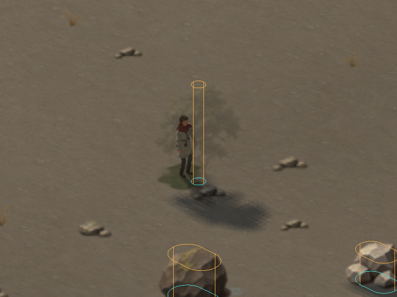
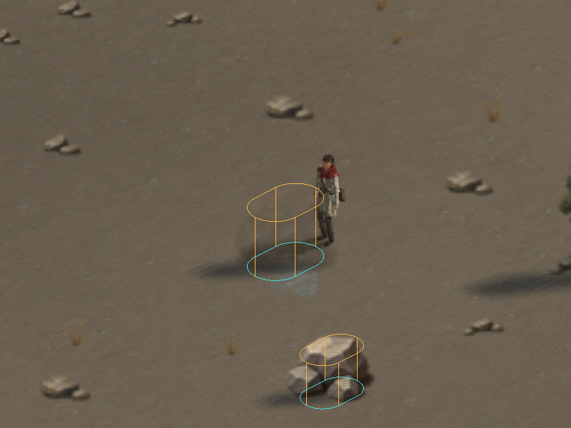
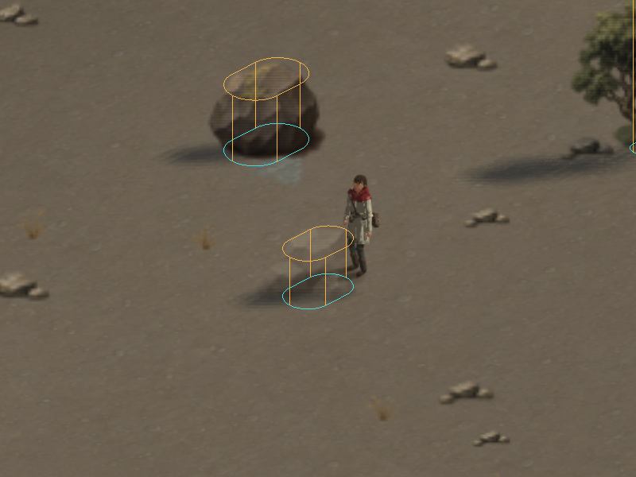
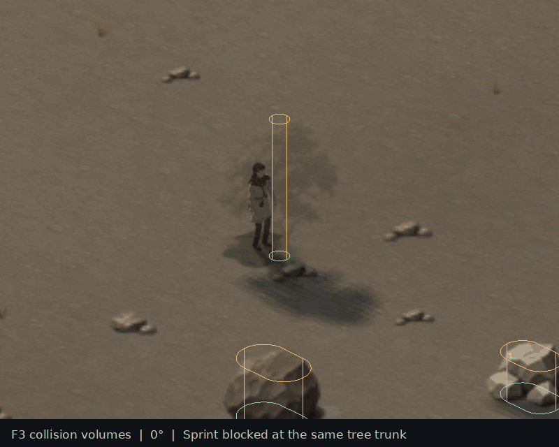

# Object collision

Characters collide with solid scenery in world space. A vertical cylinder
represents the character's body. Tree trunks use circular footprints; boulders
and stone, iron and gold piles use rounded capsule footprints with finite
height. Footprints follow each object's seeded position, variant and scale.
Q/E rotation, camera zoom, sprite transparency and art reload do not change
collision geometry.

Trees block at the trunk. The space under a crown remains accessible when
there is room for the body, and forest tiles no longer act as invisible square
walls around their individual trees. Bushes, grass, flowers, reeds and small
pebbles remain walkable. Cliff edges, deep water, mountains and map boundaries
still block movement; ramps and fords retain their existing rules.

Press **F3** to inspect the volumes, or start with `--colliders`. Cyan outlines
show the footprint; amber outlines and vertical edges show its height.

| Tree trunk | Boulder | Resource deposit |
|---|---|---|
|  |  |  |

These captures hold sprint into each object for 150 fixed steps, then show the
stopped character against its collider. The same contact position is retained
at every camera angle:



## Simulation

`TileMap::scenery` contains the shared object placements and physical volumes.
Map generation builds it once; the renderer consumes that list rather than
placing its own independent trees and rocks. `build_scenery(map)` rebuilds it
after terrain or object edits. Hand-authored maps without scenery data retain
their conservative tile collision until this data is built.

The narrow phase computes continuous time of impact against the expanded
capsule sides and circular endcaps. Remaining movement projects along the
contact normal, allowing smooth sliding around trunks and rounded rocks.
Several contact iterations handle corners and gaps; a small separation margin
avoids repeated contact jitter. Thin objects cannot be skipped by a large
displacement. Short terrain steps retain the existing cliff/ramp checks.

Vertical overlap uses simulation terrace heights and continuous ramp control
nodes, independent of render LOD. The body cannot pass head-first through a
high object while its centre is still on the low end of a ramp.
Objects whose height range does not overlap the body cannot block it. Character
radius follows height and build; head clearance follows height. Spawning,
movement, autonomous waypoints and obstacle feelers all use these same volumes.
The coarse tile walkable/buildable flags remain available for generation and
strategy planning; character queries refine solid scenery into footprints.
V's passability overlay displays those coarse tile flags; F3 displays the
continuous object volumes used by the character.

A compact uniform grid indexes collider bounds in four-tile cells. Movement
checks nearby objects rather than scanning all scenery in the map. Placement
and collision are deterministic and have no window or GPU dependency.

## Verification

```sh
cmake --build build -j 5
ctest --test-dir build --output-on-failure
LIBGL_ALWAYS_SOFTWARE=1 xvfb-run -a ./build/tests/zl_render_tests
```

The dedicated `zl_collision_tests` suite checks 32 approach directions, fast
sweeps, capsule ends and sides, sliding, narrow and wide gaps, finite height,
spawn clearance, body proportions, all four camera angles, exact seeded layout
across thread counts, and deterministic autonomous movement near trees. The
existing terrain, cliff, ramp, water and movement checks remain in CTest.

GPU checks verify that shared simulation placements render identically to
the previous placement path, and that the real player controller stops at
tree, boulder and ore contacts before capture in every orientation. To
reproduce the inspection images:

```sh
LIBGL_ALWAYS_SOFTWARE=1 ZL_COLLISION_CAPTURE_DIR=/tmp/collision-proof \
  xvfb-run -a ./build/tests/zl_render_tests
```
