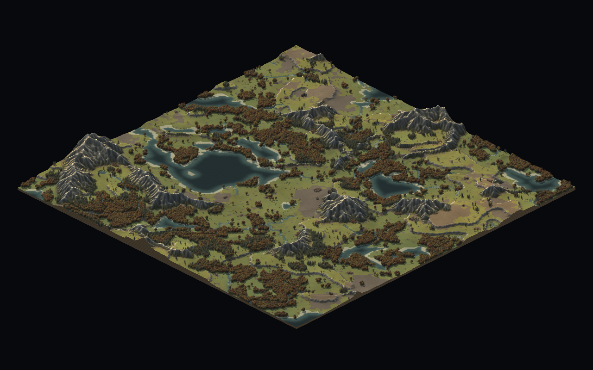
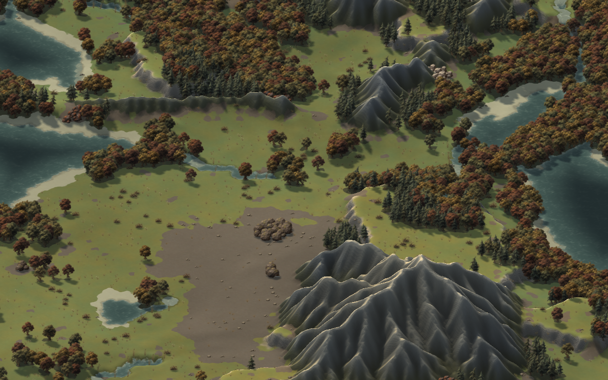
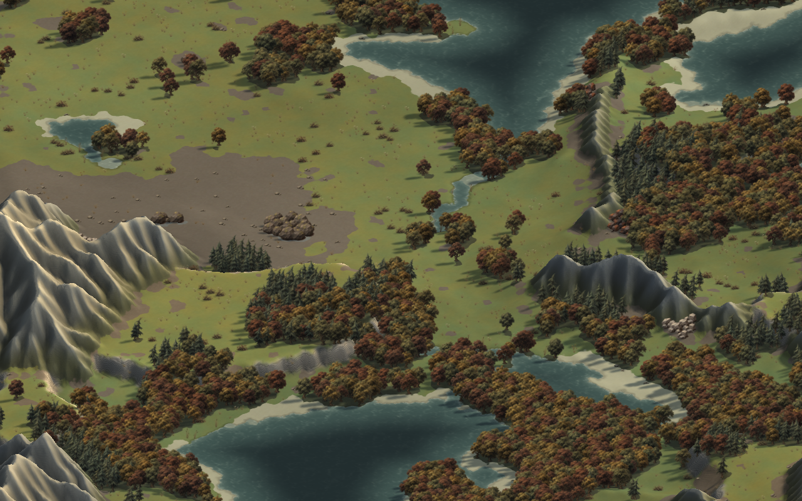

# Isometric viewer



The map uses a 2:1 orthographic projection. Elevation displaces the terrain
mesh vertically, so mountains and terraces have real silhouettes and can hide
scenery behind them. Ramps follow the height field. Rock skirts close the four
map boundaries, including rectangular maps and partial terrain chunks.

Q rotates counterclockwise and E rotates clockwise, in 90° steps. Rotation
pivots around the visible terrain at the centre of the screen and keeps the
zoom. WASD, arrows and drag-panning move in screen directions at every angle.
The wheel keeps the terrain under the cursor fixed, including on elevated
ground. F frames the entire silhouette; H returns to the start area.

The title bar shows the current angle. Key presses come from queued GLFW
events, so a brief tap survives a slow rendered frame and holding Q or E does
not repeatedly rotate the camera.

For reproducible captures, add `--rotation 0`, `90`, `180` or `270`:

```sh
./build/game/zillions --seed 7 --size 256 --resolution 1 \
  --width 1280 --height 800 --center 135 110 --zoom 16 \
  --rotation 90 --screenshot /tmp/isometric-90.png
```

| Initial view | Rotated 90° |
|---|---|
|  |  |

## Artwork and rendering

The existing painted ground textures are mapped onto the terrain in simulation
coordinates. Trees, rocks, ore and ground cover remain upright billboards;
their existing angled silhouettes and painted contact shadows suit this view,
so replacement artwork is unnecessary. Camera rotation reorders their world
anchors while preserving their upright appearance and screen-relative light.
Terrain lighting rotates consistently with the painted sprites.

Geometry uses an R32F height texture rather than the lighting texture's packed
8-bit heights. Conservative chunk bounds include elevated silhouettes, and
visible chunks share a tessellation level to avoid cracks. Sprite anchors and
ray picking use the exact triangles drawn at the current tessellation level.
Picking traverses mesh cells and intersects triangles from front to back.

Scenery is cached in four stable back-to-front orders. Per-fragment depth treats
the area above an anchor as upright and the contact shadow below it as ground.
Blended sprite edges do not write depth. Both the window and offscreen render
targets have depth attachments, so F2 captures retain the live view's occlusion.
Grid and debug overlays follow the same projected terrain. The simulation grid,
generator and movement rules stay in their original world coordinates.

## Validation

Build and run the regular headless suite, then the explicit GPU checks:

```sh
cmake --build build -j 5
ctest --test-dir build --output-on-failure
LIBGL_ALWAYS_SOFTWARE=1 xvfb-run -a ./build/tests/zl_render_tests
```

The headless camera checks cover all four orientations, elevated projection
round trips, the 2:1 ratio, screen-relative motion, anchored zoom, and wrapping
negative and positive turns. The GPU checks cover upright and shadow depth,
plateau picking, resolutions 1/2/4, four rotations, multiple zooms, rectangular
map edges, framing, exact four-turn return, framebuffer resizing, and live-window
versus screenshot output. Both painted and fallback art paths run these checks.

Live X11 input checks also exercise Q/E in both directions, wraparound, held
keys, panning, dragging, wheel zoom, F/H framing, grid and height overlays,
F5 reload, F2 capture, and a clean Escape exit. Whole-map screenshots were
reviewed at all four orientations with seed 7.
