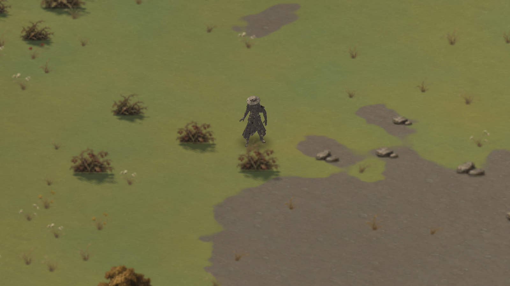
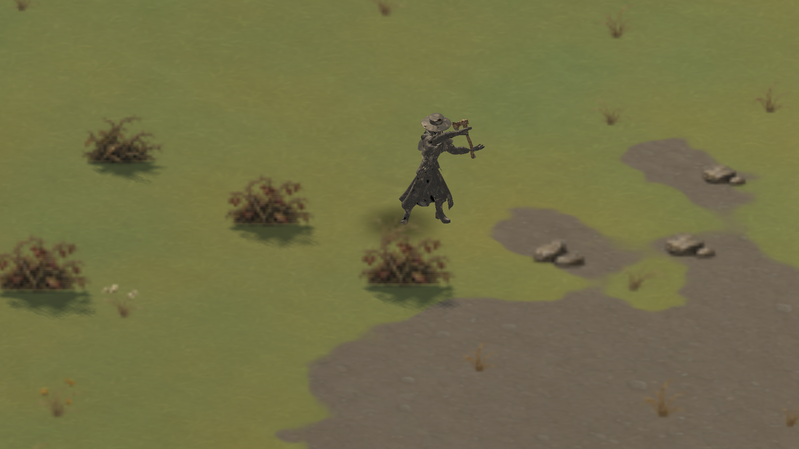
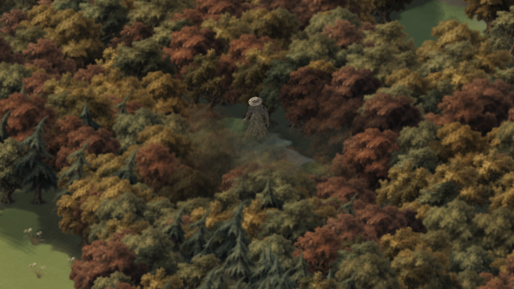
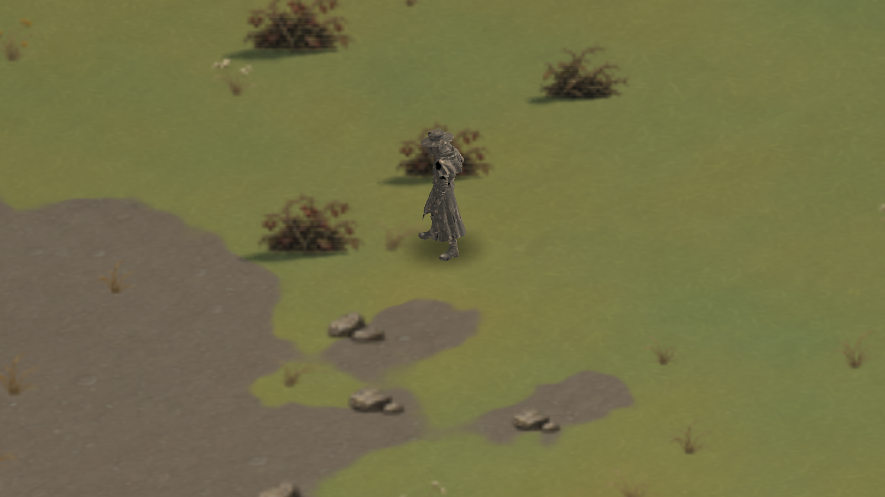
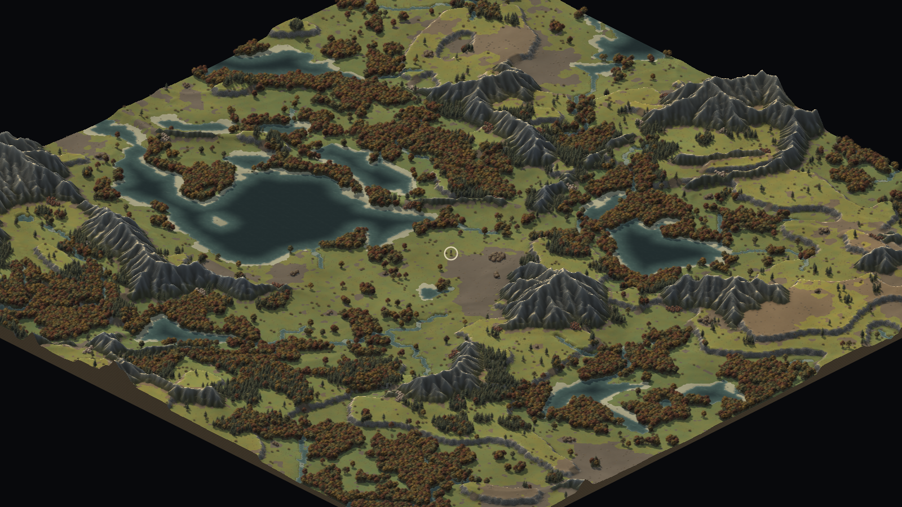
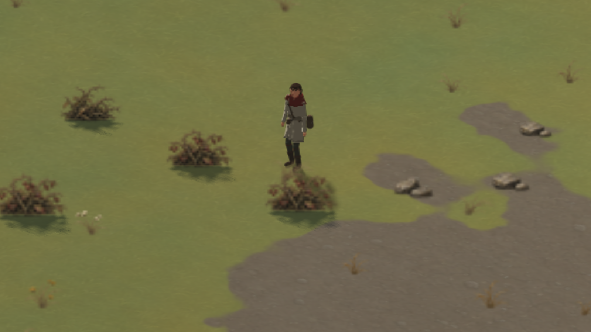
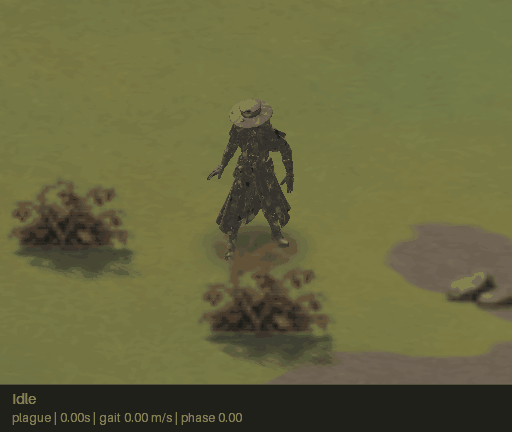

# The plague doctor

The player is a skinned glTF model, not the procedural human. The plague
doctor walks, jogs and sprints with authored clips, swings a real axe or
pickaxe from its right hand, and wades through fords with its legs clipped at
the waterline. The procedural figure remains as the missing-model fallback and
as the reference rig for the painted sprite path; see
[the character notes](character.md).



## Assets

| File | Geometry | Skin | Animation |
|---|---|---|---|
| `assets/models/plague_character.glb` | 239,173 vertices, 862,395 indices, one primitive | 24 Mixamo joints, one skin | Idle 4.0 s, Walking 1.033 s, Running 0.633 s, Heavy_Hammer_Swing 1.833 s, Right_Hand_Sword_Slash 1.5 s |
| `assets/models/axe.glb` | 153,732 vertices, 861,744 indices | none | static |
| `assets/models/pickaxe.glb` | 120,689 vertices, 669,360 indices | none | static |

The character's bind pose is 1.70 m tall with its feet at the origin and its
forward along +Z. The tools are about 1.9 m long with the handle along +Y, the
head at +Y and the grip near y=-0.55. All three files embed their textures; the
loader decodes only the base-colour image and downsamples the 4096² sources to
1024². The model is drawn at the game's 0.8 tiles per metre, so it stands about
1.36 tiles tall.

## Loading

`game/asset/gltf.cpp` reads a GLB (or a `.gltf` with embedded data URIs) and
keeps the subset the game needs:

- buffers, buffer views and accessors (component types, byte strides,
  normalized integers, no sparse accessors);
- node TRS or matrix transforms, parent links and the scene root;
- primitives with `POSITION`, `NORMAL`, `TEXCOORD_0`, `JOINTS_0` and
  `WEIGHTS_0`, with weights normalized to one;
- skins with joints and inverse bind matrices;
- LINEAR and STEP animation channels (CUBICSPLINE is rejected);
- base-colour materials, decoded with stb_image and box-filtered to at most
  1024².

Static primitives have their node transform baked into the vertices. Skinned
primitives stay in mesh space, as glTF requires. The loader returns a readable
error and leaves the model empty on failure, so the game can fall back without
a partial mesh. The hand node is found by name (`mixamorig:RightHand`).

`tests/test_gltf.cpp` loads all three real files and checks vertex and index
counts, skin joints, clip names and durations, normalized weights, joint
ranges, bounds, texture sizes, downsampling and failure cases.

## Animation

`game/actor/plague.cpp` is the headless state machine. It samples the clips
into local node transforms, blends them, composes the node globals, and writes
`bones[i] = global[skin.joints[i]] * inverse_bind[i]` for the vertex shader.

- **Locomotion.** Speed selects Idle, Walking or Running. Changing clips starts
  a 0.18 s crossfade, phase-synced to the new clip's duration.
- **Playback rate.** Walking and Running advance at `speed / reference`, so the
  authored feet move at the same ground speed as the player. The references are
  measured from the toe's planted travel per cycle: 1.32 m/s for Walking and
  4.73 m/s for Running (`kPlagueWalkReference`, `kPlagueRunReference`). At the
  game's 1.5 m/s walk, 3.0 m/s jog and 5.2 m/s sprint the feet do not slide.
  The model is fed the actual ground speed (velocity projected on the heading),
  not the procedural rig's `1 + 0.28 sin²(heading)` cadence adjustment.
- **Work.** The axe and pickaxe use `Heavy_Hammer_Swing`; hand gathering uses
  `Right_Hand_Sword_Slash`. The action time follows the survival strike's
  `work_phase` (Hammer 0.25..1.45 s, Slash 0.10..0.55 s), and the action fades
  over the locomotion with a 0.12 s time constant. When a strike wraps, the
  previous end pose is blended into the new wind-up over 0.10 s, so repeated
  chops do not snap.
- **Tool anchor.** The right hand's global matrix is normalized (the armature
  scale is 0.01) and kept in metres. The renderer attaches the tool with
  `hand * R_x(-90°) * R_y(blade yaw)`, which points the shaft out of the palm
  and the head up. The axe uses a -90° blade yaw; the pickaxe uses 0°.

`tests/test_plague.cpp` checks clip selection, crossfade, the hand anchor,
finite matrices, the measured stride speeds, the strike-wrap blend and the
tool transform.

## Rendering

`game/render/model_renderer.cpp` draws the character and the active tool in the
isometric scene:

- **Transform.** glTF is Y-up; the shader applies `T(position) * R_z(heading +
  π/2) * S(0.8) * R_x(90°)`. The model faces +Z, so `heading + π/2` makes it
  face the player's movement direction.
- **Projection and depth.** Vertices use the same isometric projection and
  depth formula as the terrain and sprites. The model writes depth, so southern
  scenery occludes it; the scene splits scenery at the player's ground depth
  and fades tall foreground sprites around the model's projected bounds.
- **Light and shadow.** The shader samples the cached sun shadow map, uses the
  terrain's warm sun and a lifted warm ambient/fill, and adds a rim and a small
  specular highlight. The near-black coat stays readable in tree shade.
- **Water.** Fragments below `ground + wade * 0.8` are discarded, so the legs
  disappear into a ford at the waterline.
- **Contact shadow and marker.** A soft ground-projected ellipse grounds the
  character. The far-zoom marker fades in below 16 px/tile and is at full
  strength below 9, with a minimum 13-pixel radius; it is drawn after the
  southern scenery so trees do not hide it.
- **Tools.** The tool mesh is uploaded with its grip moved to the origin and
  scaled to 0.34 (about 0.65 m). It is drawn after the character with the same
  depth buffer, so the hand and body occlude the handle correctly. Only the
  active tool is drawn, and only while the player is working.

The model pass is three draw calls: contact shadow, character and tool. At
800×600 on an AMD RX 560 the measured frame times are 1.345 ms at 64 px/tile
and 1.446 ms at 256 px/tile, with 0.017–0.020 ms of CPU submit time. The model
loads in about 1.8 s, dominated by decoding and downsampling the embedded
textures.









## Fallback

If `models/plague_character.glb` cannot be read, the game logs the reason and
draws the procedural painted human instead. The fallback keeps the existing
looks, hood, painted/smooth styles, character sheet and held-tool cutouts.
When the model is present, the player's body is fixed to the hero's dimensions
and the seeded-look controls are ignored, so the collision body cannot change
without the visible model changing.



## Validation

```sh
cmake --build build --config Release -j 8
ctest --test-dir build -C Release --output-on-failure
./build/tests/Release/zl_model_render_tests.exe   # needs a display
```

The headless suite includes `zl_model_tests` (loader) and `zl_plague_tests`
(animator). The GPU suite checks that the model covers pixels, that idle,
running, the axe, wading and the marker change the image, that the waterline
removes the lower body, and that the reveal bounds are non-empty. The recorded
demo uses the normal controller and renderer:

```sh
python3 tools/record_demo.py docs/character/plague-demo.gif \
  --binary build/game/Release/zillions.exe
```



The demo's state log is `docs/character/plague-demo.json`. Its `rig` entries
describe the procedural fallback's joints, not the GLB skeleton; the model's
clip selection is visible in the caption (`plague` style).

## Limits

One live skinned character is cheap; a horde of them is not. The 287k-triangle
character and 223–287k-triangle tools are fine for the player, but the horde
still needs sprite baking or a lower-detail variant before thousands of units
move. There is no combat yet, so the sword-slash clip is used for hand
gathering and the hammer swing for both tools. The model's photogrammetry
texture is noisy at close zoom; the shader keeps it readable but does not
repaint it.
