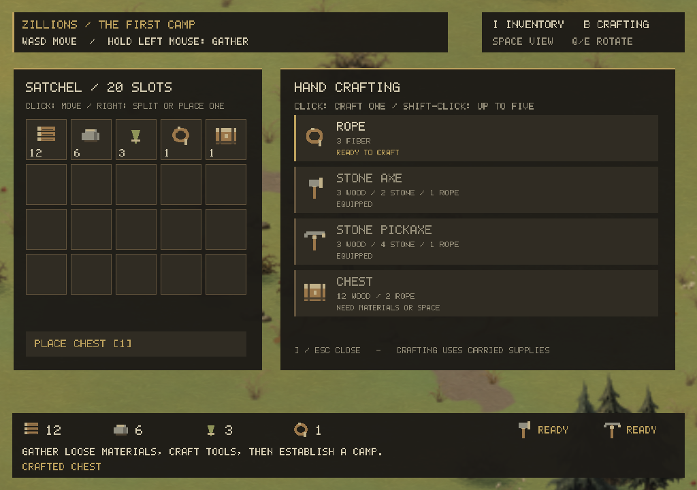
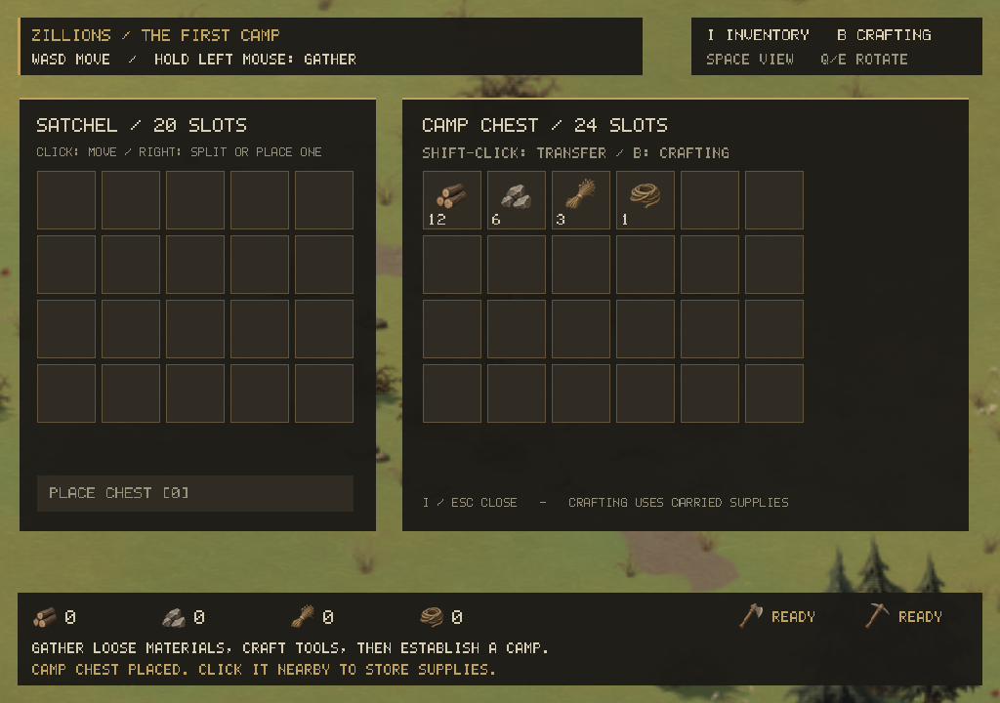
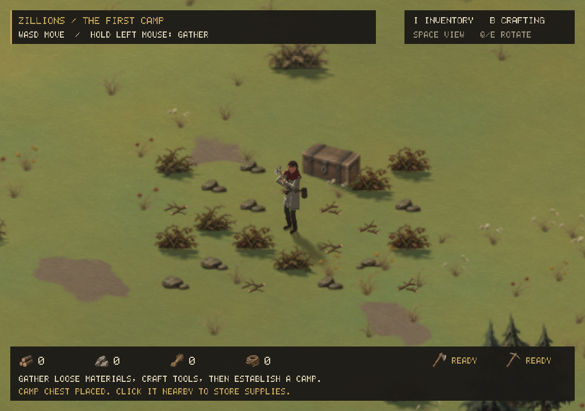
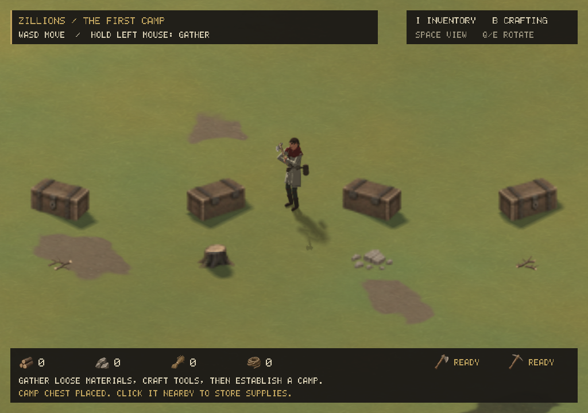
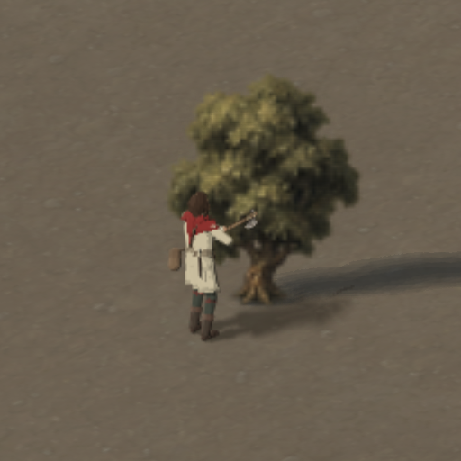
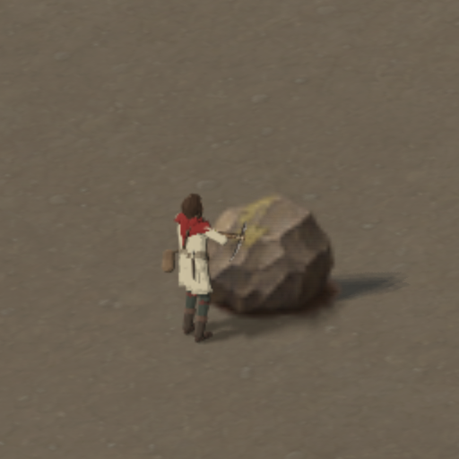

# Gathering and the first camp

The first economy runs alongside the existing character and management cameras.
The player begins with an empty 20-slot bag. Resources stack to 50, chests to
one, and the two tools occupy equipment state outside the bag. Each camp chest
has 24 slots. Crafting uses carried supplies, so returning to storage matters.
This milestone is session-only: quitting or Ctrl+R resets the economy. Ordinary
R no longer accidentally replaces the map during character play.

## Play loop

Map startup places branches, pebbles and fiber bushes on reachable open ground
near the colony start. Branches yield four wood, loose stones three stone and
bushes/reeds four fiber. Each hand-gathering cycle takes 0.45 seconds and awards
one item. The generated scenery's existing trees, boulders and stone deposits
also become resource nodes. Iron and gold await the processing/upgrades tier.

| Recipe | Cost | Craft time |
|---|---|---|
| Rope | 3 fiber | 0.6 seconds |
| Stone axe | 3 wood, 2 stone, 1 rope | 1.5 seconds |
| Stone pickaxe | 3 wood, 4 stone, 1 rope | 1.5 seconds |
| Chest | 12 wood, 2 rope | 2 seconds |

Hold left mouse near an object's ground position to gather. An axe extracts ten
wood from a tree, one per 0.85-second strike. A pickaxe extracts twelve stone
from a boulder or thirty from a deposit, one per 0.95-second strike. Movement,
release, a changed target, opening inventory or changing camera mode interrupts
the current strike. Full bags stop work without consuming another unit. Tools
are selected automatically for the resource and are permanent in this version.

Reach checks follow terrain levels, ramps and intervening solid objects. They
do not depend on camera angle. Depletion changes the existing scenery object
into a stump or rubble, removes its collider and updates the tile's terrain and
construction flags after every solid object on that tile has been cleared.
Ordinary asset reloads cannot restore harvested resources.

I/B opens inventory and crafting. Left-click picks up, merges or swaps stacks;
right-click takes half or places one item. Shift-click queues up to five crafts,
stopping when ingredients run out. Output and ingredient checks are repeated at
completion: supplies moved away during crafting cannot produce free items or
lose ingredients. Both tools are equipped when made and cannot be crafted twice.

Choose Place chest, inspect the translucent preview, use T to rotate its world
facing, and left-click nearby clear ground. Right-click/Esc cancels. The chest has a solid footprint; it cannot be
placed over the character, another obstacle, a ramp or an inaccessible level.
Click a nearby chest to open storage. Shift-click transfers to the other
container; right-click with Shift transfers one. Held stacks must be placed or
returned before closing if there is no room to return them automatically.

## Art and animation

All new world props, item icons and held tools now use image-model artwork.
The original procedural art pass has been replaced. Three transparent master
sheets and their exact prompts are retained in `assets/source/survival-*`:

| Generated assets | Runtime files |
|---|---|
| Two fallen branch arrangements, stump, rubble | `assets/sprites/branch_0..1.png`, `stump_0.png`, `rubble_0.png` |
| Four genuinely distinct views of one chest | `assets/sprites/chest_0..3.png` |
| Wood, stone, fiber, rope, axe, pickaxe, chest icons | `assets/icons/*.png` |
| Upright axe and pickaxe cutouts with aligned shafts (procedural fallback) | `assets/tools/*.png` |

`tools/art/export_survival_assets.py` only slices, aligns and downsamples those
generated images; it does not synthesize artwork. `assets/survival-manifest.json`
records source rectangles, output dimensions and anchors. The older landscape
masters, exporter and manifest are preserved. New props and old scenery share
the existing padded/mip-safe world atlas. Procedural world props remain only
as the missing-file fallback; normal play reads the image-model PNGs.

The chest has a world facing, independent of the camera. T cycles S/W/N/E while
placing it. Its long collision footprint rotates with that facing. The renderer
selects `(camera quarter-turn + world facing) % 4` for the placed sprite and
preview. The four source views
alternate their long-axis diagonal and show the front latch or back hinges as
appropriate. They are not mirrored copies. All four exports use the same
48x40 canvas, 34-pixel object width and ground anchor (24,22.5), preventing size
or position jumps. Anchors mark the center of each footprint, above the nearest
bottom corner, so wide props sit against their shadows. Future placeable props
must follow this four-view convention.

Chests cast shadows from a grounded box rotated with the world facing, independent
of the camera or painted latch/hinges. The sprite receives shadows and terrain
depth using that same box surface. Stumps use a tapered cylindrical shadow volume.
Blocker height controls filtering so low props retain a firm contact edge. Chest
paintings retain their own face lighting; only external casters add shadow to
the sprite, avoiding bands from the approximate proxy on the painted surface.

The plague doctor holds the 3D axe and pickaxe from `assets/models` in its right
hand. The tool follows the hand bone through `Heavy_Hammer_Swing`; the pickaxe
uses the same overhead swing and hand gathering uses `Right_Hand_Sword_Slash`.
The renderer moves the tool's grip to the origin, scales it to about 0.65 m and
points the head up; the tool is drawn after the body with the scene depth, so
the hand occludes the handle. See [the plague doctor notes](plague-doctor.md).

The generated alpha cutouts remain the procedural fallback's held tools. They
use a three-dimensional plane defined by the shaft and cutting edge, follow the
character's heading and swing, and keep both hands on the shaft through the
two-bone arm posing; the pickaxe swings lower to reach stone. The figure shader
samples image alpha for silhouette, depth and shadow, so transparent canvas
pixels do not become solid geometry or rectangular shadows. The fallback's body
animation stays procedural. Small chips and floating gains provide strike
feedback. Audio is a later pass.

Further buildings should begin with an image-model concept and four consistent
views, reviewed in the scene before producing variants. Colonists can reuse the
rig; zombie types need distinct silhouettes and animation cycles. The player's
plague doctor is one live skinned mesh at 1.35–1.45 ms per frame (800×600, AMD
RX 560); the horde still needs sprite baking or a lower-detail variant before
thousands of units move.

For each group, check palette, matching light, transparency, anchors, shadows,
all four camera angles and readability at 8/16/32/64 pixels per tile. Keep source
art alongside exports and use F5 for scene review. Inventory text, quantities
and progress bars remain drawn by the UI, allowing text/layout changes without
repainting assets. No new third-party assets or licenses are introduced here.













## Implementation and validation

`survival/survival.*` is headless. Resource nodes retain stable scenery indices,
and a tile index makes mouse targeting local. `rebuild_scenery_colliders()`
updates physical volumes without regenerating scenery. `refresh_objects()`
updates tile data, scenery order and shadow casters without rebuilding mountain
relief. Save/load must eventually serialize this mutable state rather than
recreate it from the original seed alone.

```sh
cmake --build build -j 5
ctest --test-dir build --output-on-failure
LIBGL_ALWAYS_SOFTWARE=1 xvfb-run -a ./build/tests/zl_survival_render_tests
LIBGL_ALWAYS_SOFTWARE=1 xvfb-run -a ./build/tests/zl_render_tests
LIBGL_ALWAYS_SOFTWARE=1 xvfb-run -a ./build/tests/zl_figure_render_tests
LIBGL_ALWAYS_SOFTWARE=1 xvfb-run -a ./build/tests/zl_model_render_tests
```

The survival suite checks stack conservation, split/transfer behavior, recipe
transactions, full bags, tool gates, cancellation, depletion/collision,
multi-object tiles, bootstrap supplies across seeds and resolutions, chest
placement, tool poses and a complete empty-bag-to-stocked-chest simulation.
The GPU suite clicks actual HUD hit boxes to craft both tools and a chest,
splits/returns a held stack, transfers supplies and renders props/tools at all
four camera angles. It also checks four distinct placed facings, rotated
colliders, directional previews and transparent tool shadows. Shadow checks cover
ground contact at two elevations, all four camera angles and all four chest
facings, with matching opposite-facing volumes. Strike captures exercise both
tools against actual targets; pose checks verify the blade plane and both hands
through the full cycle across character variants and headings. Those pose checks
exercise the procedural fallback; `zl_model_render_tests` covers the plague
doctor's skinned mesh, tool and waterline. Existing terrain and figure suites
remain applicable.

Set `ZL_SURVIVAL_CAPTURE_DIR=/tmp/survival-review` on the survival GPU command to
write the review frames. Tool poses can also be inspected independently; with
the plague doctor loaded this poses the 3D model and axe, and with the fallback
it poses the painted cutout:

```sh
./build/game/zillions --seed 7 --size 256 --resolution 1 --zoom 180 \
  --tool axe --work-phase 0.4 --screenshot /tmp/axe.png
```

A live X11 input check also gathers the three starter materials, crafts rope
and an axe through the UI, then switches to management mode and rotates the
camera. F2 captures the current framebuffer, including the gameplay HUD.
