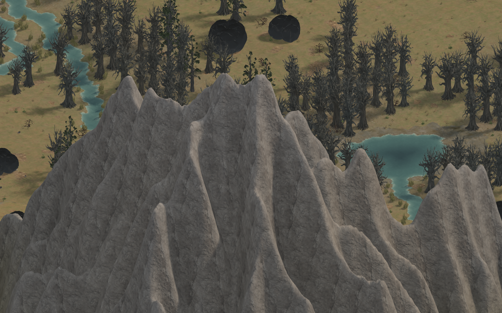
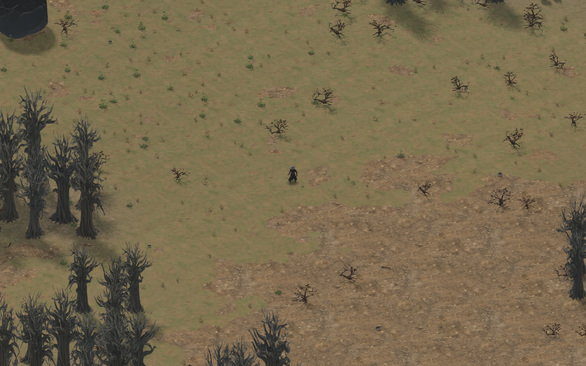

# Ground and mountain materials





The seven ground albedos are now 1024² CC0 scans from Poly Haven, replacing the
256² source-sheet crops. Grass, forest litter, dry soil, gravel and sand have
their own seamless surfaces. Exact source URLs, authors, provider checksums
and local SHA-256 hashes are recorded in `assets/ground/materials.json` and the
main art inventory. Original PNGs are preserved; grading happens in the shader.

Mountains and terrace walls use world-aligned triplanar projection. Vertical
height participates in texture coordinates, so a steep slope keeps its texel
density instead of stretching a top-down image into streaks. Four-metre rock
fractures combine with larger mineral variation to break repeated patterns.
The heightfield normal blends projections smoothly across mesh triangles.

The rock scan also supplies packed ambient-occlusion/roughness/metallic data
and displacement. Surface-gradient bump mapping turns the displacement into
small-scale normal detail without moving gameplay geometry. Roughness controls
the highlight, crevices reduce ambient illumination, and the base colour stays
in the shared linear-light pipeline. Packed maps are linear data. Trilinear
mipmaps and a distance fade keep fine bump detail stable at distant zooms.

The ground loader accepts complete square sets at one shared power-of-two
resolution from 256 to 2048. Missing, malformed or mixed-size albedos trigger
the existing complete-group procedural fallback. Water and noise remain seeded
shader data; periodic bilinear resampling preserves their frequency when the
authored material resolution changes. Missing rock data uses a neutral material.
Sprite resolution and atlas placement are independent of ground resolution.

Loose geometry is deliberately sparse. Peak bush probability is about 73%
lower, woodland branch probability about 87% lower and rocky-district pebble
probability about 85% lower than the first density pass. Nonlinear biome weights
keep these props concentrated in occasional patches. Ground-cover plants and
shore reeds are also thinned; forest tree placement and resource deposits retain
their existing density. Reachable starter crafting supplies are still guaranteed.
On the matched seed-7 512² map, ground props fall from 102,213 to 34,939
(about 66% fewer), with the same 12,100 trees.

To restore the exact material files without credentials or paid generation:

```sh
python3 tools/art/fetch_terrain_materials.py
```

The importer verifies Poly Haven's hashes and preserves matching files. The
legacy sprite-sheet exporter respects the new material manifest and does not
overwrite the ground scans. Poly Haven assets use [CC0](https://polyhaven.com/license).

`zl_terrain_material_tests` executes the shared GLSL with synthetic material
fixtures. It checks two-dimensional detail on all three projection planes,
unchanged normals for flat displacement, visible relief for varying displacement,
and a stable flat response after the distance fade. Existing art tests cover
the real 1K files, resolution-independent shader data and incomplete-group
fallbacks. Biome checks bound debris density while retaining forest density
and distinct meadow, thicket and scree distributions.
